<div align="center">

# Grand Support Copilot

**Триаж обращений игроков, черновики ответов на языке игрока и рабочее место администратора**

Кейс 03 · Grand Mobile × Decentrathon 6.0 · LLM + RAG


</div>

---

## Содержание

1. [Что это и зачем](#1-что-это-и-зачем)
2. [Результат в цифрах](#2-результат-в-цифрах)
3. [Соответствие ТЗ](#3-соответствие-тз)
4. [Как это работает](#4-как-это-работает)
5. [Быстрый старт](#5-быстрый-старт)
6. [API `POST /triage`](#6-api-post-triage)
7. [Пакетный запуск `make predict`](#7-пакетный-запуск-make-predict)
8. [Интерфейс администратора](#8-интерфейс-администратора)
9. [Безопасность ответов и борьба с галлюцинациями](#9-безопасность-ответов-и-борьба-с-галлюцинациями)
10. [Метрики, стоимость, задержка](#10-метрики-стоимость-задержка)
11. [Конфигурация](#11-конфигурация)
12. [Структура репозитория](#12-структура-репозитория)
13. [Тесты и воспроизводимость](#13-тесты-и-воспроизводимость)
14. [Честные ограничения](#14-честные-ограничения)
15. [Данные, приватность, лицензии](#15-данные-приватность-лицензии)
16. [Карта документации](#16-карта-документации)

---

## 1. Что это и зачем

Grand Mobile получает сотни тысяч обращений: **жалобы на игроков** из лаунчера и **репорты** из игры на шести языках. Администраторы разбирают их вручную, поэтому однотипные вопросы занимают время, а серьёзные случаи тонут в потоке.

**Support Copilot** — автономный сервис, который не требует доступа к коду или API игры:

| Что делает сервис | Как |
| --- | --- |
| Определяет **язык**, **категорию** (14) и **приоритет** (p0–p3) | нормализация текста, правила и признаки, подмена символов cp1251 для казахского |
| Отсеивает **спам и дубли** | эвристика пустых сообщений и дедупликация «один игрок · одна проблема · один час» |
| Извлекает **факты** | ник, ссылки на пункты правил, наличие вложений, сервер |
| Готовит **черновик ответа** на языке игрока | RAG по 11 разделам правил (280 фрагментов) + проверенные шаблоны |
| Ссылается на **правила без выдумок** | каждая цитата проверяется на существование, раздел, релевантность и дословность |
| Честно говорит, **когда нужен человек** | обязательная эскалация платежей, аккаунтов, апелляций и всех жалоб |
| Даёт **рабочее место администратора** | очередь, правка, эскалация, история правок как обучающий сигнал, кластеры шаблонов |

> [!IMPORTANT]
> Главный принцип ТЗ: **не выдумывать правила и не обещать того, чего сервис не может**. Поэтому черновики не обещают наказание, разбан или возврат денег и не утверждают, что скриншоты просмотрены: изображений сервис не получает, только их количество.

---

## 2. Результат в цифрах

| Показатель | Значение | Порог ТЗ | Статус |
| --- | --- | --- | --- |
| Обращений обработано без ошибок (валидация) | **1 000 / 1 000** | — | ✅ |
| Неизвестных (выдуманных) цитат | **0** | 0 | ✅ |
| Опасных обещаний в черновиках (фильтр) | **0** | 0 | ✅ |
| Accuracy категории на контрольной выборке | **44 / 45 = 97,8%** | — | ⚠️ саморазметка |
| Macro-F1 по приоритету (3 присутствующих класса) | **1,000** (общий 0,750 — класса p0 в выборке нет) | — | ⚠️ саморазметка |
| Доля `needs_human` | **94%** | — | осознанно высокая |
| Стоимость обращения (живая модель, 8 вызовов) | **≈ $0,00052** (максимум $0,00063) | ≤ $0,002 | ✅ |
| Стоимость в локальном режиме | **$0** | — | ✅ |
| p95 локального HTTP `/triage` | **308 мс** | ≤ 5 000 мс | ✅ |
| p95 живой модели (макс. из 8 вызовов) | **1 823 мс** | ≤ 5 000 мс | ✅ |
| Автоматические тесты | **59 / 59** | — | ✅ |

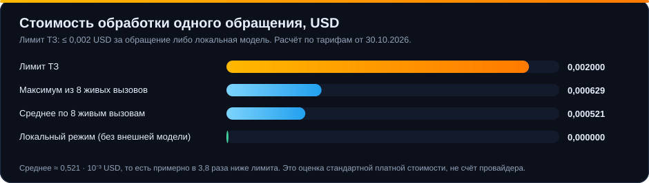

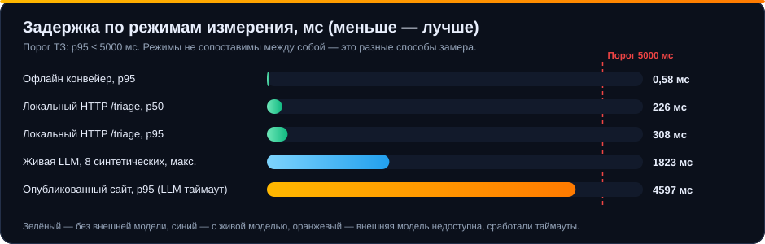

> [!WARNING]
> Метрики классификации получены на **выборке из 45 обращений, размеченной ассистентом**, а не людьми. Это контроль регрессий, а не независимая оценка. Слепая оценка администраторами и носителями kk/uz **ещё не проводилась**; пакеты для неё подготовлены ([REVIEW-INSTRUCTIONS.md](REVIEW-INSTRUCTIONS.md)). Подробности и оговорки — в [REPORT.md](REPORT.md).

---

## 3. Соответствие ТЗ

Критерии оценки кейса и их вес:

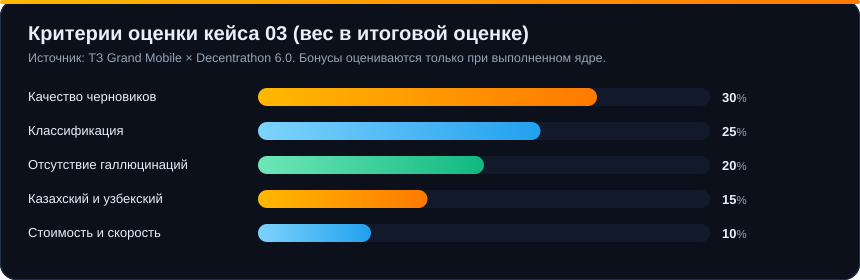

Краткая матрица требований (полная — в [docs/TZ-COMPLIANCE.md](docs/TZ-COMPLIANCE.md)):

| Требование ТЗ | Статус | Где реализовано |
| --- | :---: | --- |
| HTTP-сервис `POST /triage` по контракту | ✅ | [app/triage/route.ts](app/triage/route.ts), [lib/contract.mjs](lib/contract.mjs) |
| `make predict IN=… OUT=…` | ✅ | [Makefile](Makefile), [scripts/predict.mjs](scripts/predict.mjs) |
| Язык, категория, приоритет | ✅ | [lib/triage.mjs](lib/triage.mjs), [lib/features.mjs](lib/features.mjs) |
| Спам и дубли | ✅ | [lib/dedup.mjs](lib/dedup.mjs), [lib/dedup-store.mjs](lib/dedup-store.mjs) |
| Извлечение ника, пунктов, вложений, сервера | ✅ | [lib/triage.mjs](lib/triage.mjs) |
| RAG по правилам обязателен | ✅ | [lib/rag.mjs](lib/rag.mjs), [lib/retrieval-query.mjs](lib/retrieval-query.mjs) |
| Цитаты существуют и релевантны | ✅ | [lib/citation-policy.mjs](lib/citation-policy.mjs), [lib/gemini.mjs](lib/gemini.mjs) |
| Нет обещаний разбана, возврата, наказания | ✅ | [lib/policy.mjs](lib/policy.mjs) |
| Платежи, апелляции, взлом → человеку всегда | ✅ | [lib/policy.mjs](lib/policy.mjs) |
| Нормализация символов cp1251 (ќ ґ ѕ є ј ў ї) | ✅ | [lib/triage.mjs](lib/triage.mjs) |
| Ответы админов и исход не попадают во вход | ✅ | [lib/input.mjs](lib/input.mjs) |
| Стоимость ≤ $0,002 или локальная модель | ✅ | [lib/usage.mjs](lib/usage.mjs) |
| p95 ≤ 5 с | ✅ | бюджет 2 500 мс в [lib/analyze-core.mjs](lib/analyze-core.mjs) |
| Отчёт: метрики, примеры, доля человека, стоимость, задержка | ✅ | [REPORT.md](REPORT.md) |
| **Бонус** · дедупликация | ✅ | [lib/dedup.mjs](lib/dedup.mjs) |
| **Бонус** · предложения шаблонов по кластерам | ✅ | [public/template-clusters.mjs](public/template-clusters.mjs) |
| **Бонус** · интерфейс админа с сохранением правок | ✅ | [public/workspace.js](public/workspace.js), [lib/ticket-store.mjs](lib/ticket-store.mjs) |

---

## 4. Как это работает

```mermaid
flowchart LR
    P([Игрок: лаунчер или игра]) -->|жалоба / репорт| API["POST /triage"]
    API --> G["Входной фильтр<br/>без ответов админа и исхода"]
    G --> N["Нормализация<br/>cp1251 → kk, регистр, апострофы"]
    N --> C["Язык · категория · приоритет<br/>ник · пункты · вложения · сервер"]
    C --> PO{"Обязательная<br/>эскалация?"}
    PO --> R["RAG: BM25 по 11 разделам<br/>280 фрагментов"]
    R --> L{"Внешняя модель<br/>разрешена?"}
    L -->|"да, синтетика"| LLM["LLM: строгая JSON-схема"]
    L -->|нет или сбой| FB["Безопасный шаблон<br/>на языке игрока"]
    LLM --> V["Проверка: схема · цитаты · дословность<br/>язык · опасные обещания"]
    V -->|не прошла| FB
    V -->|прошла| OUT
    FB --> OUT["Ответ по контракту ТЗ"]
    PO -.->|"needs_human = true"| OUT
    OUT --> Q[(Очередь в R2)]
    Q --> UI["Интерфейс администратора:<br/>правка · эскалация · подтверждение"]
    UI -->|правки как обратная связь| Q
```

Подробнее — [docs/ARCHITECTURE.md](docs/ARCHITECTURE.md): последовательность запроса, бюджеты времени, схема принятия решения о человеке, проверка цитат, модель данных и жизненный цикл обращения.

### Принцип «сначала безопасность, потом полезность»

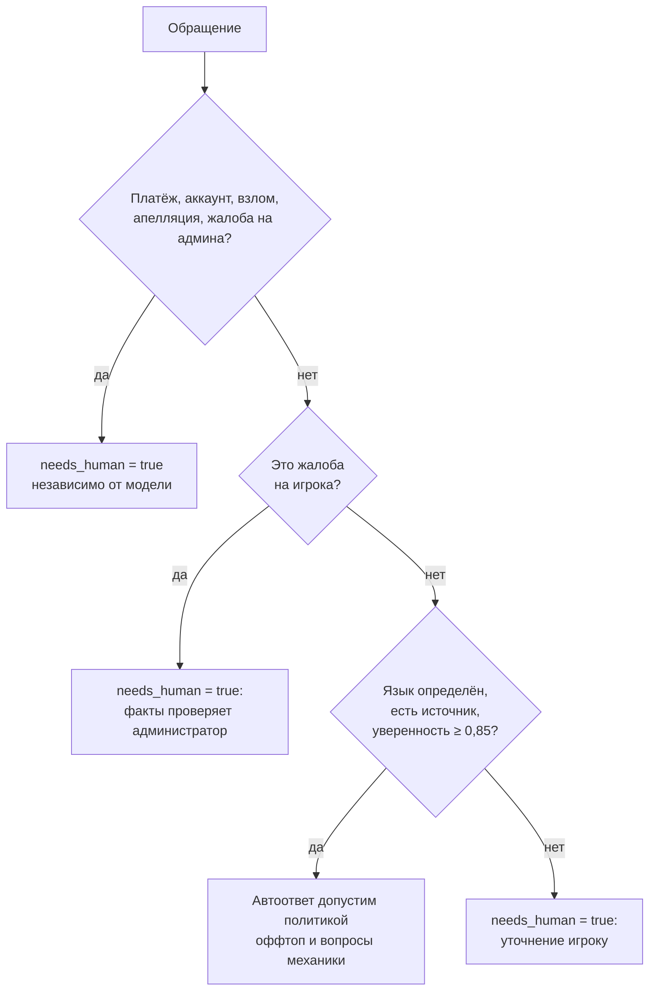

---

## 5. Быстрый старт

**Требуется:** Node.js 22.13+ и Python 3 (только для подготовки данных).

```sh
cd support-copilot
npm ci

# Подготовка корпуса правил из архива организаторов (создаёт .private/, исключён из Git)
python scripts/prepare-data.py ../Данные/grand-support-copilot-handout-2026-10-27.tgz

# Запуск сервиса и интерфейса
npm run dev -- --host 127.0.0.1 --port 4173
```

Откройте <http://127.0.0.1:4173> — интерфейс администратора. Проверка:

```sh
curl -X POST http://127.0.0.1:4173/triage \
  -H "Content-Type: application/json" \
  -d '{"kind":"complaint","messages":[{"role":"player","text":"Arman_Petrov оскорблял меня и мою семью в чате, сервер 4, скрины есть, 2.1 ОП","attachments":2}]}'
```

> [!NOTE]
> Локальное R2-хранилище (Miniflare) отличается от опубликованного. Веб-сервис получает корпус через защищённый `POST /api/corpus` (заголовок `x-rag-admin-token`), а пакетный запуск читает `.private/corpus.json`. Инструкция импорта — [GEMINI_SETUP.md](GEMINI_SETUP.md). Без корпуса сервис не падает, а возвращает безопасное уточнение с `needs_human: true`.

---

## 6. API `POST /triage`

**Запрос** (минимум по ТЗ; поддерживается и исходная схема датасета: `images_count`, `reported_nick`, `rule_refs_raw`, `reporter_hash`, `reported_hash`, `created_at`, `server`):

```json
{
  "kind": "complaint",
  "messages": [
    { "role": "player", "text": "Игрок Arman_Petrov оскорблял меня и мою семью в чате на 4 сервере. Прикрепил 2 скриншота.", "attachments": 2 }
  ]
}
```

**Ответ** (реальный вывод сервиса на синтетическом обращении; `analysis` сокращён):

```json
{
  "lang": "ru",
  "category": "complaint.insult",
  "priority": "p1",
  "is_spam_or_duplicate": false,
  "extracted": { "nickname": "Arman_Petrov", "rule_refs": ["2.1"], "has_evidence": true, "server": "4" },
  "draft_reply": {
    "lang": "ru",
    "text": "Здравствуйте! Пункт 2.1 общих правил запрещает оскорбления игроков и их родственников. Приложенные материалы и обстоятельства должен проверить администратор. Уточните время события.",
    "cited": ["2.1"]
  },
  "needs_human": true,
  "confidence": 0.95,
  "reasons": ["Нужно проверить обстоятельства и черновик ответа"],
  "analysis": {
    "qualified_citations": ["Общие правила игры § 2.1"],
    "citation_mode": "grounded",
    "llm_status": "generated",
    "corpus_documents": 280,
    "cost_usd": null,
    "estimated_paid_cost_usd": 0.0005053
  },
  "latency_ms": 1823
}
```

Что важно знать:

- В `draft_reply.cited` и `extracted.rule_refs` — **короткие номера** пунктов, как в ТЗ (`2.1`). Номера повторяются в разных разделах, поэтому однозначные ссылки `Раздел § Пункт` лежат в `analysis.qualified_citations`, а тексты первоисточников — в `analysis.cited_sources`.
- Пример ответа в ТЗ противоречит собственным ограничениям (обещает мут и «видит» скриншоты). Мы следуем ограничениям: **ни одного обещания и ни одного утверждения о просмотре вложений**.
- `confidence` — самооценка или эвристика, **не калиброванная вероятность**. Поле `analysis.calibration` явно показывает статус.
- Любой сбой (нет корпуса, таймаут, квота, невалидный ответ модели) даёт безопасный черновик, `needs_human: true` и причину в `analysis.llm_status`.

Полное описание полей, ошибок и остальных маршрутов — [docs/API.md](docs/API.md).

---

## 7. Пакетный запуск `make predict`

```sh
make predict IN=.private/tickets_valid.jsonl OUT=.private/pred-valid.jsonl
# или без make:
node scripts/predict.mjs .private/tickets_valid.jsonl .private/pred-valid.jsonl
```

- Одна строка входа → одна строка выхода; порядок сохраняется.
- Ошибочная запись даёт строку `{"line": N, "error": "…"}`, а процесс завершается с ненулевым кодом.
- Вход и выход не могут быть одним файлом.
- Дедупликация работает по скользящему окну из 10 000 записей (нужны `reporter_hash` и `created_at`).
- Поля `admin`, `verdict`, `punishment`, `violation`, `category`, `priority` **отбрасываются до анализа**.

Демонстрационный прогон на 8 синтетических обращениях (RU/KK/UZ, платёж, аккаунт, читы, дубль):

```sh
node scripts/predict.mjs examples/synthetic-tickets.jsonl .private/pred-synthetic.jsonl
```

| ticket_id | язык | категория | приоритет | дубль | человек | цитата |
| --- | :---: | --- | :---: | :---: | :---: | :---: |
| DEMO-RU-01 | ru | `complaint.insult` | p1 | — | ✅ | 2.1 |
| DEMO-KK-02 | kk | `complaint.insult` | p1 | — | ✅ | 2.1 |
| DEMO-UZ-03 | uz | `complaint.insult` | p1 | — | ✅ | 2.1 |
| DEMO-PAY-04 | ru | `report.payment` | **p0** | — | ✅ | без правила |
| DEMO-ACC-05 | kk | `report.account` | **p0** | — | ✅ | 1.4 |
| DEMO-CHEAT-06 | ru | `complaint.cheat` | p1 | — | ✅ | 5.2 |
| DEMO-DEDUP-07 | ru | `report.help` | p2 | — | ✅ | без правила |
| DEMO-DEDUP-08 | ru | `report.help` | p2 | **да** | ✅ | без правила |

> [!NOTE]
> Внешняя модель вызывается **только** для записей с `"data_mode": "synthetic"`. Для остальных обращений сервис работает локально и ничего не передаёт провайдеру. Это осознанный переключатель приватности; если вход заведомо анонимизирован и вы разрешаете внешний вызов, пометьте записи этим полем.

---

## 8. Интерфейс администратора

Очередь, черновик, анализ и действия на одном экране: приоритеты `P0–P3`, фильтры по приоритету, языку, категории и серверу, пагинация, подсказки «Следующее действие», правка черновика, эскалация, подтверждение с явной проверкой, экспорт JSON, тестовый канал с квитанцией. Правки сохраняются как обратная связь.

<table>
<tr>
<td width="50%"><b>Казахский: черновик на языке игрока</b><br></td>
<td width="50%"><b>Узбекский: черновик на языке игрока</b><br></td>
</tr>
<tr>
<td width="50%"><b>Платёж: p0, обязательно человек, без обещания возврата</b><br></td>
<td width="50%"><b>История решений и кандидаты в шаблоны</b><br></td>
</tr>
</table>

Интерфейс адаптивный: на планшете и телефоне навигация уходит вниз, а карточка обращения занимает всю ширину.

<table>
<tr>
<td width="62%" valign="top"><b>Планшет</b><br></td>
<td width="38%" valign="top"><b>Телефон</b><br></td>
</tr>
</table>

Подробное руководство администратора — [docs/UI-GUIDE.md](docs/UI-GUIDE.md).

> [!NOTE]
> На снимках используются **только синтетические обращения**. Тексты фрагментов правил намеренно размыты, чтобы не публиковать материалы датасета.

---

## 9. Безопасность ответов и борьба с галлюцинациями

Ответ модели не доверяется — он **проверяется программно**, а при любом сомнении заменяется безопасным шаблоном.

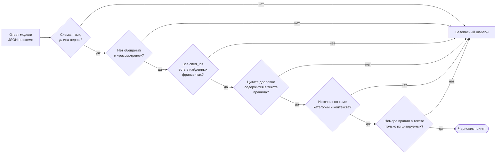

| Риск | Защита |
| --- | --- |
| Выдуманный пункт правил | цитировать можно только фрагменты из выдачи RAG; номер в тексте обязан совпадать с цитируемым источником |
| Одинаковые номера в разных разделах | идентификатор фрагмента включает раздел: `id = раздел:пункт:часть` |
| Слишком общий источник | [citation-policy](lib/citation-policy.mjs): узкие правила (дом, зелёная зона, уход из РП) не используются без соответствующих признаков |
| Обещание наказания, возврата, разбана | регулярные фильтры на ru/kk/uz/en/es/pt в [policy.mjs](lib/policy.mjs) и повторная проверка финального текста |
| «Жалоба рассмотрена», «по скриншотам видно» | фильтр вымышленных статусов; сервис не просматривает вложения |
| Утечка исхода в модель | входной фильтр оставляет только `player` и `reported_player`; метки и ответы админов отбрасываются |
| Утечка персональных данных наружу | ники, ссылки, e-mail, телефоны маскируются перед внешним вызовом; для реальных данных внешний вызов отключён |
| Факты из жалобы приняты за истину | в тексте всегда «обстоятельства должен проверить администратор»; интерфейс помечает вложения как «не проверены» |

Эти проверки доказывают **существование и дословность** цитаты, но не заменяют оценку релевантности человеком.

---

## 10. Метрики, стоимость, задержка

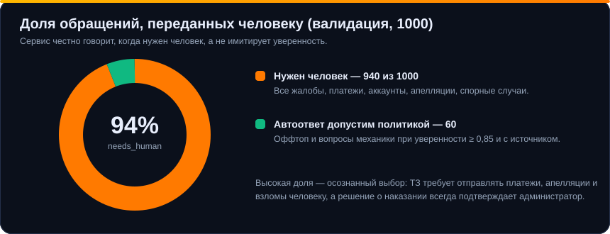

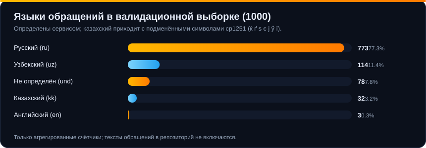

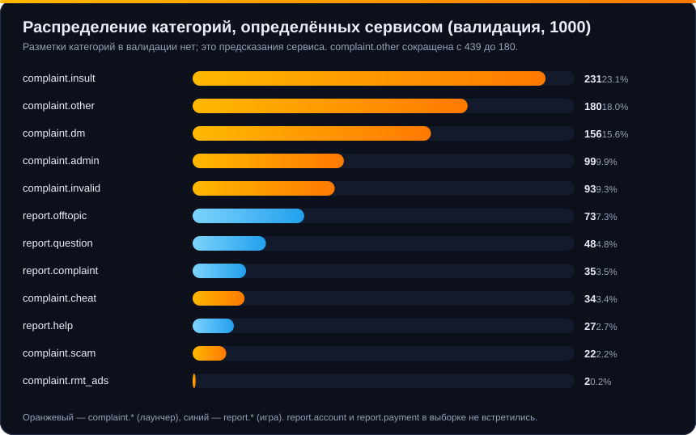

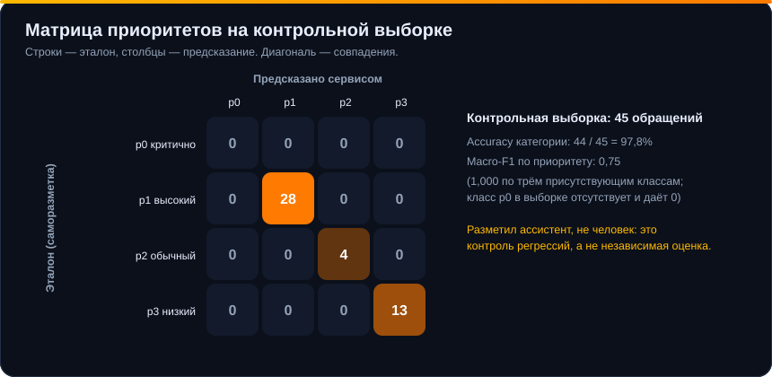

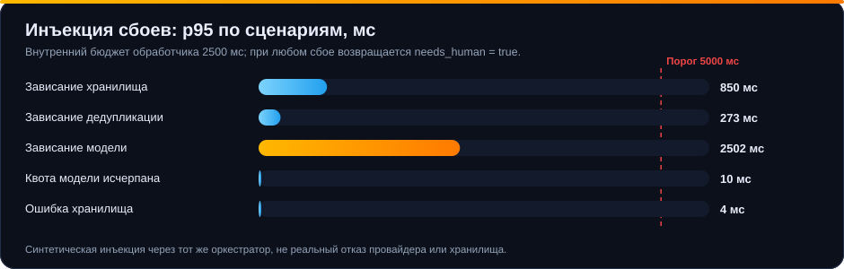

Полный разбор, примеры черновиков на ru/kk/uz и честные оговорки — [REPORT.md](REPORT.md). Метрики лежат в [docs/metrics.json](docs/metrics.json), графики воспроизводятся командой `node scripts/make-doc-charts.mjs`.

---

## 11. Конфигурация

Секреты хранятся только в игнорируемом `.env.local` и в серверных переменных окружения — **не в Git и не в браузере**.

| Переменная | Где используется | Назначение |
| --- | --- | --- |
| `LLM_BASE_URL`, `LLM_API_KEY`, `LLM_MODEL`, `LLM_EXTERNAL_ENABLED` | веб-сервис (`/triage`, `/api/tickets`) | OpenAI-совместимый провайдер; без ключа сервис работает локально |
| `GEMINI_API_KEY`, `GEMINI_MODEL`, `GEMINI_EXTERNAL_ENABLED` | `make predict` | прямой вызов Gemini для синтетических записей |
| `CORPUS_PATH` | `make predict` | путь к корпусу, по умолчанию `.private/corpus.json` |
| `RAG_ADMIN_TOKEN` | `POST /api/corpus` | секрет для импорта корпуса в R2 |

```dotenv
# пример .env.local (значения подставьте свои)
LLM_BASE_URL=https://example-provider.invalid/v1
LLM_API_KEY=...
LLM_MODEL=...
LLM_EXTERNAL_ENABLED=true
GEMINI_API_KEY=...
GEMINI_MODEL=gemini-3.5-flash-lite
GEMINI_EXTERNAL_ENABLED=true
CORPUS_PATH=.private/corpus.json
```

Стоимость нового провайдера по `LLM_*` заранее неизвестна: сервис возвращает `usage` и не записывает неизвестную стоимость как нулевую. После смены настроек перезапустите сервер.

---

## 12. Структура репозитория

```text
support-copilot/
├── app/
│   ├── triage/route.ts            POST /triage — контракт ТЗ
│   └── api/
│       ├── tickets/               очередь и действия администратора
│       ├── knowledge/             поиск и просмотр базы правил
│       ├── corpus/                статус и защищённый импорт корпуса
│       └── test-delivery/         тестовая «отправка» с квитанцией
├── lib/
│   ├── input.mjs                  входной фильтр: без ответов админа и исхода
│   ├── triage.mjs, features.mjs   нормализация, язык, категория, приоритет
│   ├── policy.mjs                 обязательная эскалация, запрет обещаний
│   ├── rag.mjs, retrieval-query   BM25 + игровые синонимы
│   ├── gemini.mjs, gemini-wire    генерация по JSON-схеме и проверка ответа
│   ├── citation-policy.mjs        релевантность и дословность цитат
│   ├── fallback.mjs, editorial    безопасные шаблоны на 6 языках
│   ├── analyze-core.mjs           бюджеты времени и оркестрация
│   ├── dedup*.mjs                 дедупликация игрок · проблема · час
│   ├── ticket-store.mjs           очередь, версии, ETag, история
│   └── usage.mjs                  токены и оценка стоимости
├── public/                        интерфейс администратора (HTML, CSS, JS)
├── scripts/                       predict, evaluate, benchmark, review, charts
├── tests/                         59 автоматических тестов
├── examples/                      синтетические обращения (без данных кейса)
├── docs/                          архитектура, API, соответствие ТЗ, графики
├── Makefile                       цель predict
├── README.md · REPORT.md          этот файл и отчёт по метрикам
└── .private/                      данные кейса и производные — только локально, не в Git
```

---

## 13. Тесты и воспроизводимость

```sh
npm test                 # 59 тестов: контракт, RAG, цитаты, политики, очередь, дедупликация
npm run typecheck        # TypeScript без ошибок

node scripts/evaluate.mjs .private/tickets_valid.jsonl .private/final-valid.json
node scripts/evaluate.mjs .private/review-check.jsonl  .private/final-check.json
node scripts/benchmark-http.mjs http://127.0.0.1:4173 240 8 private   # локальный HTTP p95
node scripts/benchmark-faults.mjs                                     # инъекция сбоев
node scripts/make-doc-charts.mjs                                      # графики документации
node scripts/capture-docs.mjs                                         # снимки интерфейса
```

---

## 14. Честные ограничения

- **Нет независимой оценки.** Метрики классификации — на 45 обращениях, размеченных ассистентом; в выборке нет p0 и казахского. Слепая оценка администраторами и носителями kk/uz — следующий шаг.
- **Категории и приоритеты валидации не размечены организаторами**, поэтому accuracy и macro-F1 на всей валидации посчитать нельзя; для 1 000 обращений есть только распределение предсказаний.
- **Высокая доля `needs_human` (94%).** Все жалобы на игроков идут к человеку по политике; автоответ допустим только для оффтопа и простых вопросов механики. Это безопасно, но снижает автоматизацию.
- **Спам-детектор простой**: эвристика пустых сообщений плюс дедупликация по токенам (порог сходства 0,75).
- **Уверенность не калибрована**; калибровка — офлайн-диагностика, в маршрутизацию не включена ([CALIBRATION.md](CALIBRATION.md)).
- **Вложения не анализируются**: сервису доступно только их число.
- **Задержка опубликованного сайта** с недоступным внешним провайдером: p95 4 597 мс при 16 таймаутах — на пределе порога 5 с ([RELEASE-VERIFICATION.md](RELEASE-VERIFICATION.md)).
- **Реальной доставки игроку нет**: интеграция с игрой вне задачи; «тестовый канал» только сохраняет квитанцию.

---

## 15. Данные, приватность, лицензии

- Данные Grand Mobile (`rules.json`, `taxonomy.json`, `tickets_*.jsonl`) **не публикуются** и исключены из Git (`.private/`, `*.jsonl`, `*.tgz`, кроме `examples/*.jsonl`). Графики и отчёт содержат только агрегаты.
- Срок удаления данных и производных — [DATA-RETENTION.md](DATA-RETENTION.md): не позднее **4 декабря 2026**.
- Реальные обращения не передаются внешним провайдерам; внешний вызов — только для явно помеченных синтетических записей.
- Деанонимизация игроков не выполнялась и не предусмотрена.

| Компонент | Назначение | Лицензия |
| --- | --- | --- |
| Node.js, Web Standard APIs | среда выполнения | MIT |
| Next.js, React, Tailwind CSS, Radix UI, Lucide | веб-интерфейс | MIT |
| vinext, Vite | сборка и dev-сервер | MIT |
| Cloudflare Workers, Wrangler, Miniflare | платформа и локальная эмуляция R2 | Apache-2.0 / MIT |
| Google Gemini API (`gemini-3.5-flash-lite`) | опциональная генерация для синтетики | [условия Google](https://ai.google.dev/gemini-api/terms) |
| Данные кейса Grand Mobile | правила, таксономия, валидация | проприетарные, только для Decentrathon 6.0 |

---

## 16. Карта документации

| Документ | О чём |
| --- | --- |
| [REPORT.md](REPORT.md) | отчёт по ТЗ: метрики, графики, примеры черновиков, стоимость, задержка, ограничения |
| [docs/ARCHITECTURE.md](docs/ARCHITECTURE.md) | диаграммы: компоненты, запрос, решение о человеке, проверка цитат, данные, жизненный цикл |
| [docs/API.md](docs/API.md) | все маршруты, поля, ошибки, примеры |
| [docs/TZ-COMPLIANCE.md](docs/TZ-COMPLIANCE.md) | построчная трассировка требований ТЗ к коду и тестам |
| [docs/UI-GUIDE.md](docs/UI-GUIDE.md) | руководство администратора со снимками экрана |
| [docs/metrics.json](docs/metrics.json) | агрегированные метрики для графиков |
| [GEMINI_SETUP.md](GEMINI_SETUP.md) | подключение модели и импорт корпуса |
| [CALIBRATION.md](CALIBRATION.md) | диагностика уверенности |
| [REVIEW-INSTRUCTIONS.md](REVIEW-INSTRUCTIONS.md) | протокол независимой оценки |
| [RELEASE-VERIFICATION.md](RELEASE-VERIFICATION.md) | проверка опубликованной версии |
| [DATA-RETENTION.md](DATA-RETENTION.md) | сроки хранения и удаления данных |
| [TODO-TZ.md](TODO-TZ.md) | оставшиеся задачи |
