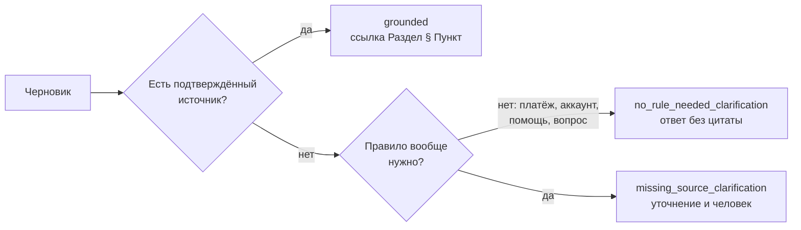
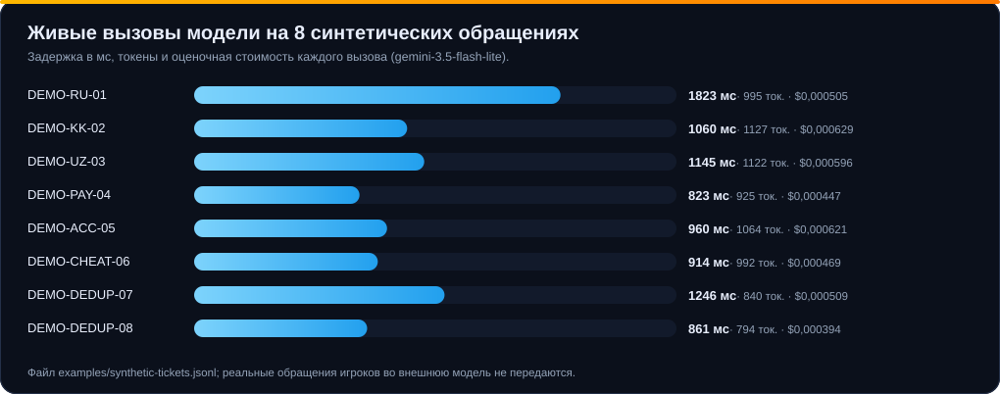
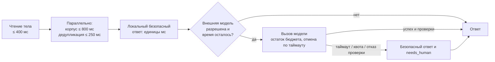

# Отчёт: Grand Support Copilot

**Кейс 03 · Grand Mobile × Decentrathon 6.0 · Support Copilot — ассистент поддержки и разбора жалоб**

Обновлено 31 октября 2026. Все числа ниже воспроизводимы скриптами из репозитория; агрегаты лежат в [docs/metrics.json](docs/metrics.json), графики строятся `node scripts/make-doc-charts.mjs`.

> [!IMPORTANT]
> Независимые человеческие оценки (слепая оценка администраторами, оценка носителями kk/uz, разметка категорий) **ещё не получены**. Метрики классификации ниже рассчитаны на небольшой выборке, размеченной ассистентом, и служат контролем регрессий, а не независимой оценкой качества.

---

## 1. Резюме

| Требование ТЗ | Результат | Оценка уверенности в результате |
| --- | --- | --- |
| Обязательное ядро: `POST /triage`, `make predict`, RAG, эскалация | реализовано, 1 000 / 1 000 обращений без ошибок | высокая |
| Цитаты правил существуют | 558 цитат, **0 неизвестных** | высокая (существование), средняя (релевантность) |
| Нет обещаний наказания, разбана, возврата | **0** срабатываний фильтра на 1 000 черновиков | средняя — это фильтр, а не доказательство |
| Платежи, апелляции, взлом → человеку | обязательная политика, не зависит от модели | высокая |
| Стоимость ≤ $0,002 за обращение | **≈ $0,00052** с живой моделью, $0 локально | высокая (8 измерений) |
| p95 ≤ 5 с | **308 мс** локальный HTTP; **1 823 мс** максимум живой модели | высокая |
| Доля «нужен человек» | **94%** | осознанная политика |
| Классификация | 44 / 45 категорий верно на контроле | низкая — саморазметка, малая выборка |
| Казахский и узбекский | черновики на языке игрока, нормализация cp1251 | низкая — носители не оценивали |
| Бонусы | дедупликация, кластеры шаблонов, интерфейс админа | высокая (демонстрируются) |

---

## 2. Как закрывается каждый критерий оценки


| Критерий (вес) | Что сделано | Чего не хватает |
| --- | --- | --- |
| **Качество черновиков (30%)** | RAG по 11 разделам правил; ответ на языке игрока; всегда просит недостающие факты (сервер, время); не «выносит приговор» | слепая оценка администраторов |
| **Классификация (25%)** | 14 категорий, 4 приоритета, нормализация, игровой сленг (`дм`, `дб`, `тк`, `рк`, `ск`, `нрп коп`), узбекская латиница и кириллица | независимая разметка валидации |
| **Отсутствие галлюцинаций (20%)** | цитировать можно только найденные фрагменты; проверка раздела, пункта, дословности и релевантности; безопасный шаблон при сомнении | аудит релевантности цитат человеком |
| **Казахский и узбекский (15%)** | замена `ќ ґ ѕ є ј ў ї`; шаблоны kk/uz; проверка языка ответа | оценка носителями |
| **Стоимость и скорость (10%)** | $0,00052 за обращение, локальный режим $0; p95 ≪ 5 с; бюджет 2,5 с и деградация к шаблону | замер на опубликованной инфраструктуре с живой моделью |

---

## 3. Данные и методика

| Набор | Размер | Назначение | Замечание |
| --- | --- | --- | --- |
| `tickets_train.jsonl.gz` | 118 337 обращений | изучение распределений и формулировок | категории и приоритеты не размечены |
| `tickets_valid.jsonl` | 1 000 обращений | прогон сервиса, распределения | категории и приоритеты **не размечены**, вердикт и наказание есть |
| Контрольная выборка | 45 обращений | accuracy и macro-F1 | разметил ассистент; нет p0 и казахского |
| Авторская регрессия | 24 синтетических случая | шесть языков, p0–p3 | использовалась при разработке, не независима |
| `examples/synthetic-tickets.jsonl` | 8 обращений | живой вызов модели, демонстрация | полностью синтетические |

**Защита от утечки ответа.** Вердикт, наказание, нарушенный пункт и сообщения роли `admin` присутствуют в датасете, но [`prepareInput`](lib/input.mjs) отбрасывает их до анализа; метки `category` и `priority` тоже не попадают в конвейер. Тест `dataset adapter includes image counts and discards outcomes and admin replies` это проверяет.

**Скриншотов нет.** В выгрузке только их количество (`images_count`), поэтому сервис нигде не утверждает, что «видел» вложение.

---

## 4. Классификация

### Распределение предсказаний на валидации (1 000 обращений)


Эвристики усилены в ходе работы: доля неопределённой категории `complaint.other` снизилась **с 439 до 180**. Число цитат на промежуточной версии доходило до 758, а на итоговой равно 558: после аудита ТЗ политика цитат стала консервативнее и не подставляет узкие правила без соответствующих признаков ([citation-policy](lib/citation-policy.mjs)).

### Языки


Казахских обращений **32** (3,2%), узбекских **114** (11,4%): именно на них приходится 15% оценки, хотя доля в потоке мала. `und` (7,8%) — короткие и пустые сообщения, где язык надёжно не определяется; такие обращения всегда уходят человеку.

### Контрольная выборка: категория и приоритет


| Метрика | Значение | Комментарий |
| --- | --- | --- |
| Accuracy категории | **44 / 45 = 97,8%** | разметка ассистента |
| Macro-F1 приоритета | **0,750** | по четырём классам |
| F1 по присутствующим классам p1, p2, p3 | **1,000** | p0 в выборке нет → общий macro-F1 занижен |

> [!WARNING]
> 45 обращений — слишком мало, чтобы судить о точности на скрытом тесте из 500 обращений. Цифры показывают, что эвристики работают на разобранных случаях, но не гарантируют обобщение. Подготовлены 120 обращений для независимой разметки ([REVIEW-INSTRUCTIONS.md](REVIEW-INSTRUCTIONS.md)).

---

## 5. Качество черновиков: реальные примеры

Все примеры — фактический вывод сервиса на синтетических обращениях (живая модель + проверки). Экспертная оценка языка **не выполнялась**.

### 5.1 Оскорбление: русский, казахский, узбекский

| | Вход (синтетический) | Черновик | Цитата |
| --- | --- | --- | --- |
| **RU** | «Здравствуйте! Игрок Arman_Petrov оскорблял меня и мою семью в чате на 4 сервере. Прикрепил 2 скриншота.» | Здравствуйте! Пункт 2.1 общих правил запрещает оскорбления игроков и их родственников. Приложенные материалы и обстоятельства должен проверить администратор. Уточните время события. | Общие правила игры § 2.1 |
| **KK** | «Сәлеметсіз бе! Nurlan_Sadykov мені және отбасымды чатта балағаттады, сервер 1, скриншот бар.» | Сәлеметсіз бе! Жалпы ойын ережелерінің 2.1-тармағында ойыншыларды және олардың туыстарын қорлауға тыйым салынған. Қоса берілген материалдар мен мән-жайды әкімші тексеруі керек. Оқиға уақытын нақтылап жазыңыз. | Общие правила игры § 2.1 |
| **UZ** | «Salom, Rustam_Aliev meni chatda haqorat qildi va onamdan so'kdi. Server 2, skrinshot bor.» | Salom! Umumiy o‘yin qoidalarining 2.1-bandida o‘yinchilar va ularning qarindoshlarini haqorat qilish taqiqlangan. Ilova qilingan materiallar va vaziyatni administrator tekshirishi kerak. Hodisa vaqtini aniqlashtiring. | Общие правила игры § 2.1 |

`complaint.insult` · приоритет `p1` · `needs_human: true` во всех трёх случаях.

### 5.2 Критичные случаи: человек обязателен, обещаний нет

| Случай | Категория | Приоритет | Черновик | Что важно |
| --- | --- | :---: | --- | --- |
| **Платёж** (RU) «Оплатил донат… деньги списались, в игре ничего не пришло» | `report.payment` | **p0** | Здравствуйте! Для проверки платежа специалисту нужны дата и время покупки, название товара и чек. Не отправляйте пароль или полные данные банковской карты; зачисление и возврат можно подтвердить только после проверки. | не обещает возврат; просит чек; предупреждает про пароль и карту |
| **Аккаунт** (KK) «Аккаунтыма кіре алмаймын, ќўпиясөз өзгеріп кеткен…» | `report.account` | **p0** | Сәлеметсіз бе! Аккаунтқа кіру немесе мүлік мәселесін қолдау қызметінің маманы тексеруі керек. Құпиясөз бен растау кодтарын ешкімге бермеңіз; қалпына келтіруге алдын ала кепілдік берілмейді. | подменённые cp1251-символы распознаны; не обещает восстановление |
| **Читы** (RU) «стреляет через стены с аимботом… видео приложил» | `complaint.cheat` | p1 | Здравствуйте! Пункт 5.2 общих правил запрещает использование стороннего ПО и читов. Приложенные материалы и обстоятельства должен проверить администратор. Уточните время события. | не утверждает, что видео просмотрено; не обещает наказание |
| **Застрял** (RU) «Застрял в текстурах возле гаража…» | `report.help` | p2 | Здравствуйте! Укажите сервер, точное местоположение и обстоятельства игровой проблемы для проверки администратором. | правило не нужно (`no_rule_needed_clarification`) |
| **Повтор** тем же игроком через 5 минут | `report.help` | p2 | то же уточнение | `is_spam_or_duplicate: true`, связь с исходным обращением в `analysis.duplicate_of` |

### 5.3 Что отличает наш ответ от примера в ТЗ

В [ТЗ](Decentrathon%206.0_%20Grand%20Mobile%20Support%20Copilot.md) пример ответа содержит «По скриншотам видно нарушение… получит мут на 30 минут». Это противоречит ограничениям того же ТЗ (нельзя обещать наказание), а изображений сервис не получает. Мы следуем **ограничениям**: ни обещаний, ни утверждений о просмотре вложений; обвинения игрока подаются как недоказанные.

---

## 6. Отсутствие галлюцинаций

| Показатель (валидация, 1 000) | Значение |
| --- | --- |
| Всего цитат в черновиках | 558 |
| Неизвестных цитат (несуществующий пункт или раздел) | **0** |
| Черновиков с опасным обещанием по фильтру | **0** |
| Режимы цитирования | `grounded`, `no_rule_needed_clarification`, `missing_source_clarification` (описаны ниже); распределение по режимам в сводку не вынесено |

Три режима цитирования, возвращаемых в `analysis.citation_mode`:



**Что доказывают проверки:** цитируемый фрагмент существует, принадлежит указанному разделу, цитата дословно содержится в тексте правила, номера в тексте ответа совпадают с цитируемыми источниками, тема источника соответствует категории. **Чего они не доказывают:** смысловую правильность применения правила к конкретному случаю — для этого нужна оценка администратором.

Номера правил повторяются между разделами, поэтому ссылки в индексе — `раздел:пункт:часть`, а в отчёте и интерфейсе — `Раздел § Пункт`.

---

## 7. Казахский и узбекский

| Особенность | Решение |
| --- | --- |
| Игра работает в cp1251; на kz-серверах казахские буквы набраны похожими | таблица замен `ќ→қ`, `ґ→ғ`, `ѕ→ң`, `є→ә`, `ј→ө`, `ў→ұ`, `ї→ү` применяется до анализа |
| Смесь языков в одном сообщении | язык ответа определяется по преобладающим признакам; при сомнении — `und` и передача человеку |
| Узбекский пишут латиницей и кириллицей, с разными апострофами (`o'`, `oʻ`, `o‘`) | апострофы нормализуются; словарь признаков для обеих график |
| Шаблоны ответов | полные наборы фраз для ru/kk/uz/en/es/pt: приветствие, проверка, платёж, аккаунт, апелляция, правило 2.1, «нет инструкции» |
| Ответ на другом языке, чем у игрока | проверка соответствия языка (`language_mismatch`) → безопасный шаблон |

> [!NOTE]
> Тексты kk/uz в шаблонах и в выводе модели **не проходили проверку носителями**. Для этого подготовлен пакет из 64 примеров ([REVIEW-INSTRUCTIONS.md](REVIEW-INSTRUCTIONS.md)). В поле `analysis.native_speaker_reviewed` сервис честно возвращает `false`.

---

## 8. Доля «нужен человек»


| Причина эскалации | Политика |
| --- | --- |
| Платёж, донат, возврат | всегда человек |
| Взлом, доступ к аккаунту, пропажа имущества | всегда человек |
| Апелляция бана, просьба о разбане | всегда человек |
| Жалоба на администратора | всегда человек |
| Любая жалоба на игрока | человек: факты и вложения проверяет администратор |
| Язык не определён, источник не найден, уверенность < 0,85 | человек |
| Повторное обращение | человек, со ссылкой на исходное |
| Сбой хранилища, модели, таймаут, квота | человек, безопасный шаблон |

Автоответ допустим только для оффтопа и вопросов механики при найденном источнике и уверенности не ниже 0,85. Мы сознательно выбрали **высокую долю эскалаций** вместо риска неверного автоматического ответа: по ТЗ ошибка в цитате обнуляет обращение, а решение о наказании всегда подтверждает администратор.

---

## 9. Стоимость

**Режимы.** Локальный режим (по умолчанию для обращений без пометки `data_mode: synthetic`) не делает внешних запросов и стоит **$0**. Режим с моделью включается только для синтетики.

**Измерения.** 8 живых вызовов `gemini-3.5-flash-lite` на синтетических обращениях ([examples/synthetic-tickets.jsonl](examples/synthetic-tickets.jsonl)):



| Показатель | Значение |
| --- | --- |
| Среднее токенов на обращение | ≈ 982 (пример: 901 на входе и 94 на выходе) |
| **Средняя стоимость** | **$0,000521** |
| Медиана / максимум | $0,000507 / $0,000629 |
| Лимит ТЗ | $0,002 |
| Запас до лимита | в ≈ 3,8 раза |
| Оценка на 1 000 обращений | ≈ $0,52 |
| Оценка на 100 000 обращений | ≈ $52 |


**Формула** ([lib/usage.mjs](lib/usage.mjs)): `стоимость = вход × $0,30 / 1 млн + выход × $2,50 / 1 млн`. Пример: 901 входных и 94 выходных токена дают $0,000270 + $0,000235 = **$0,000505**.

> [!NOTE]
> Это **оценка по стандартному платному тарифу** на 30 октября 2026, а не счёт провайдера. В бесплатном уровне реальные расходы нулевые, но квоты зависят от проекта Google. Сервис не переключается на платные модели автоматически и не записывает неизвестную стоимость запроса с таймаутом как нулевую (`cost_usd: null`).

Кэш проверенных ответов ([lib/generation-cache.mjs](lib/generation-cache.mjs)) ограничен по размеру и времени жизни и изолирует модель и контекст, поэтому повторные вопросы не оплачиваются повторно.

---

## 10. Задержка


| Замер | Условия | p50 | p95 | Максимум |
| --- | --- | ---: | ---: | ---: |
| Конвейер офлайн | 1 000 обращений валидации, без сети | 0,21 мс | 0,58 мс | 6,3 мс |
| **Локальный HTTP `/triage`** | 240 запросов, параллельность 8, эмулятор R2, без модели | 226 мс | **308 мс** | 856 мс |
| Живая модель | 8 синтетических обращений, последовательно | 1 010 мс | — | 1 823 мс |
| Опубликованный закрытый сайт | 16 синтетических, параллельность 2, **все вызовы модели закончились таймаутом** | — | 4 597 мс | 4 597 мс |

Первый запрос после старта: 856 мс (прогрев индекса). Порог ТЗ — **p95 ≤ 5 000 мс**.

### Бюджет времени и деградация



Общий бюджет анализа — **2 500 мс**; остальное остаётся на доставку ответа клиенту. Безопасный ответ строится **до** вызова модели, поэтому при любом сбое сервис отвечает мгновенно.

### Инъекция сбоев


Во всех пяти сценариях возвращён валидный ответ с `needs_human: true`, максимальный p95 — 2 502 мс. Это синтетическая инъекция через тот же оркестратор, а не реальный отказ провайдера или хранилища.

> [!WARNING]
> Первый опубликованный прогон (до оптимизации бюджета) дал p95 **6 390 мс** — выше порога. Мы не скрывали результат: внутренний бюджет снижен с 4 300 до 2 500 мс, ожидание корпуса — до 800 мс, дедупликации — до 250 мс. Повторный прогон: p95 **4 597 мс**. При этом внешний провайдер на опубликованной инфраструктуре **не отвечал** (16 таймаутов), поэтому успешность и задержка живой модели *в публикации* остаются непроверенными. Подробности — [RELEASE-VERIFICATION.md](RELEASE-VERIFICATION.md).

---

## 11. Бонусная часть

| Бонус | Реализация | Проверено |
| --- | --- | --- |
| **Дедупликация** «1 игрок · 1 проблема · час» | `reporter_hash` + окно 3 600 с + сходство токенов ≥ 0,75, тот же сервер и объект жалобы; в онлайне хранится до 100 обращений на игрока, в пакетном режиме — окно из 10 000 записей | тесты `dedup requires same player, issue and one-hour window`, пример DEMO-DEDUP-07/08 |
| **Предложения шаблонов** | полносвязные кластеры сходных текстов и согласованных ответов внутри категории и языка; кандидат от трёх подтверждений; известные ники и значения заменяются переменными; обязательна редакторская проверка | вкладка «История действий» |
| **Интерфейс администратора** | очередь, фильтры, пагинация, правка, подтверждение с явной проверкой, эскалация с причиной, история версий текста, экспорт JSON, тестовый канал с квитанцией; защита от конфликтов (ETag + версия) | тест `records and feedback survive storage reload, stale updates fail` |

Текстовая кластеризация основана на сходстве токенов; это не нейросетевая семантическая модель.

---

## 12. Надёжность и тесты

| Проверка | Результат |
| --- | --- |
| `npm test` | **59 / 59** пройдено |
| `npm run typecheck` | без ошибок |
| Контракт ответа | `assertContract` проверяет язык, категорию, приоритет, флаги, `confidence ∈ [0, 1]`, форму `extracted` и `draft_reply` |
| Невалидный вход | отклоняется с понятной ошибкой: ≤ 50 сообщений, ≤ 20 000 символов, `attachments` 0–100 |
| Обход эскалации | тест `mandatory policy cannot be bypassed by predicted question category` (ru, uz, en) |
| Подмена символов cp1251 | тест `cp1251 Kazakh substitutions and mixed Uzbek wording do not bypass critical escalation` |
| Опасные черновики | тест `unsafe drafts are rejected in multiple languages` (ru, kk, uz, en, es, pt) |
| Выдуманные цитаты | тесты `rejects nonexistent citations, invented quotes and textual rule numbers`, `retrieval respects sections with repeated references` |

---

## 13. Ограничения и риски

| Ограничение | Влияние | Что делать дальше |
| --- | --- | --- |
| Нет независимой разметки категорий и приоритетов | оценка классификации ненадёжна | разметить ≥ 120 обращений людьми, пересчитать accuracy и macro-F1 |
| Нет оценки администраторов и носителей kk/uz | качество черновиков и 15% критерия не подтверждены | провести слепую оценку по подготовленным пакетам |
| Высокая доля эскалаций (94%) | мало автоматизации | расширять базу проверенных инструкций механики и снижать порог после слепой оценки |
| Спам-детектор простой | возможны пропуски | добавить обучаемый детектор на обучающих данных |
| Уверенность не калибрована | нельзя использовать как вероятность | калибровка на независимой разметке ([CALIBRATION.md](CALIBRATION.md)) |
| Внешняя модель на публикации не отвечала | задержка и успех генерации в публикации не подтверждены | повторить нагрузочный тест при доступном провайдере |
| Вложения не анализируются | подтверждение доказательств остаётся человеку | не планируется: изображений нет в выгрузке |
| Реальной доставки игроку нет | цикл не замкнут | интеграция на стороне Grand Mobile |

Сервис не доказывает полное отсутствие галлюцинаций: он **не выпускает** ссылку, которую не может проверить, а во всех остальных случаях честно передаёт обращение человеку.

---

## 14. Воспроизведение

```sh
npm ci
python scripts/prepare-data.py ../Данные/grand-support-copilot-handout-2026-10-27.tgz

npm test && npm run typecheck

make predict IN=.private/tickets_valid.jsonl OUT=.private/pred-valid.jsonl
node scripts/evaluate.mjs .private/tickets_valid.jsonl .private/final-valid.json
node scripts/evaluate.mjs .private/review-check.jsonl  .private/final-check.json

npm run dev -- --host 127.0.0.1 --port 4173
node scripts/benchmark-http.mjs http://127.0.0.1:4173 240 8 private
node scripts/benchmark-faults.mjs

node scripts/make-doc-charts.mjs
node scripts/capture-docs.mjs
```

Данные кейса и производные выборки хранятся только в `.private/` и подлежат удалению не позднее **4 декабря 2026** ([DATA-RETENTION.md](DATA-RETENTION.md)). В репозиторий и в этот отчёт попали только агрегаты и полностью синтетические примеры.
