# Архитектура Grand Support Copilot

Документ описывает, как устроен сервис, почему принято каждое решение и где это находится в коде. Все диаграммы — Mermaid, GitHub отображает их без дополнительных инструментов.

← [README](../README.md) · [REPORT](../REPORT.md) · [API](API.md) · [Соответствие ТЗ](TZ-COMPLIANCE.md)

---

## 1. Контекст и границы

Организаторы **не дают доступ к коду, протоколу и API игры**, поэтому сервис автономный: принимает обращение по HTTP, возвращает решение триажа, а администратор подтверждает его в отдельном интерфейсе. Интеграция в игру — работа Grand Mobile после хакатона.

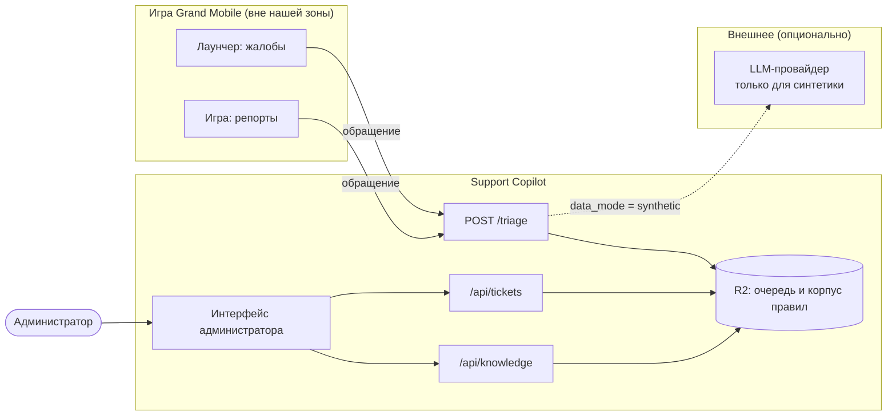

| Решение | Почему |
| --- | --- |
| Сервис независим от игры | так требует кейс: данные и контракт вместо доступа к системам |
| Корпус правил хранится в закрытом R2, а не в Git | данные кейса нельзя публиковать |
| Внешняя модель — только по явной пометке | реальные обращения не должны уходить сторонним провайдерам |
| Безопасный шаблон строится **до** обращения к модели | любой сбой даёт мгновенный и корректный ответ |
| Решение о наказании остаётся за человеком | требование ТЗ и защита от ошибок |

---

## 2. Компоненты

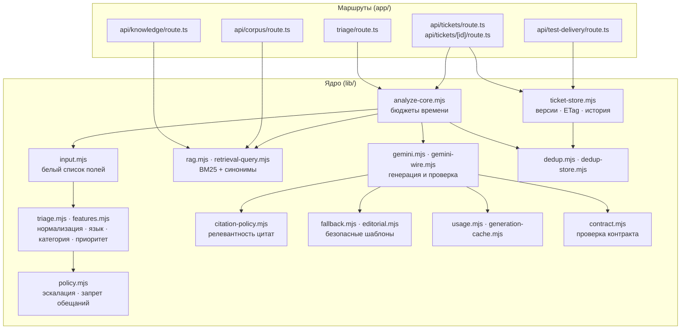

| Модуль | Ответственность |
| --- | --- |
| [input.mjs](../lib/input.mjs) | оставляет только `kind`, сообщения `player` / `reported_player`, служебные идентификаторы; отбрасывает `admin`, `verdict`, `punishment`, `violation`, `category`, `priority`; проверяет размеры |
| [triage.mjs](../lib/triage.mjs) | нормализация (NFKC, нижний регистр, cp1251 → kk, апострофы), определение языка, категории, приоритета, извлечение ника, сервера, вложений |
| [policy.mjs](../lib/policy.mjs) | `mandatoryHuman`, `permittedAutomatic`, `unsafeDraft` |
| [rag.mjs](../lib/rag.mjs) | построение корпуса и BM25-индекса, расширение запроса игровыми синонимами |
| [gemini.mjs](../lib/gemini.mjs) | запрос к модели по строгой JSON-схеме и `validateGenerated` |
| [citation-policy.mjs](../lib/citation-policy.mjs) | поддерживает ли источник заявленную тему и контекст |
| [analyze-core.mjs](../lib/analyze-core.mjs) | параллельные запросы к корпусу и дедупликации, бюджет 2 500 мс, отмена модели |
| [ticket-store.mjs](../lib/ticket-store.mjs) | запись и обновление обращений в R2 с версиями, ETag и историей |

---

## 3. Последовательность запроса `POST /triage`

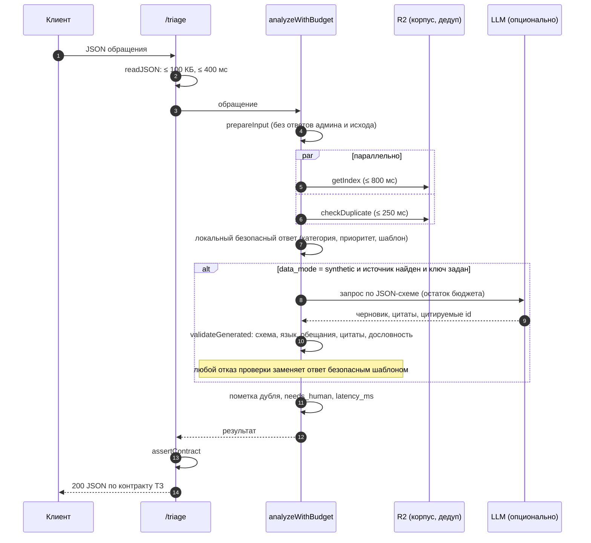

### Бюджеты времени

| Этап | Лимит | Что происходит при превышении |
| --- | ---: | --- |
| Чтение тела запроса | 400 мс | `408`, запрос отклонён |
| Ожидание корпуса | 800 мс | `llm_status = rules_not_loaded`, уточнение + человек |
| Ожидание дедупликации | 250 мс | дедупликация пропущена, `dedup_status = timeout` |
| Весь анализ | **2 500 мс** | `request_deadline_exceeded`, безопасный ответ + человек |
| Внешняя модель | остаток бюджета минус запас | отмена запроса (`AbortController`), безопасный ответ |

Запас до порога ТЗ (5 000 мс) оставлен на сетевую доставку ответа клиенту.

---

## 4. Определение категории, приоритета и языка

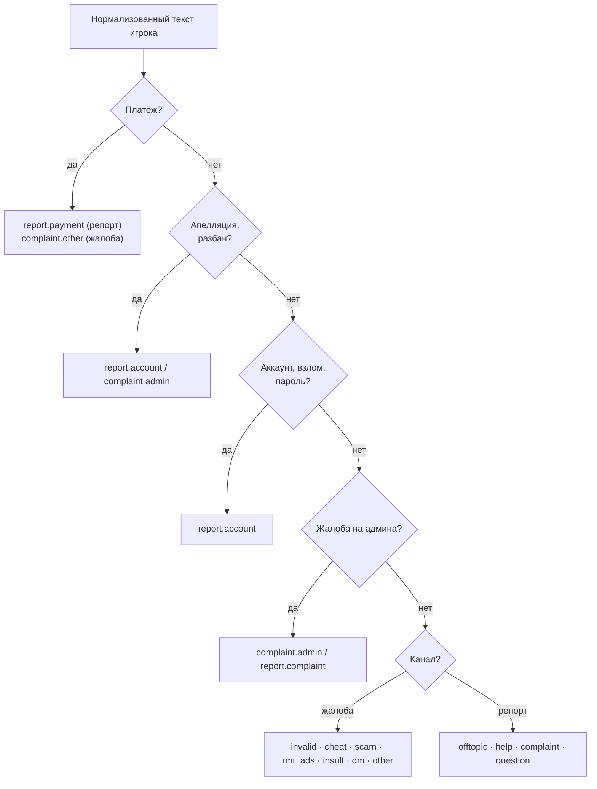

**Приоритет** следует правилам `taxonomy.json`:

| Приоритет | Условие |
| --- | --- |
| `p0` Критично | платёж, взлом или потеря доступа, критичные признаки |
| `p1` Высокий | читы, RMT-реклама, мошенничество с крупным имуществом, жалоба с вложениями |
| `p2` Обычный | оскорбления, DM, помощь в игре |
| `p3` Низкий | вопросы механики, оффтоп, жалобы без вложений, недостаточно данных |

**Язык** определяется по признакам: казахские буквы (`әғқңөұүһі`) и слова, узбекские маркеры (латиница и кириллица), кириллица → `ru`, затем `es`, `pt`, `en`; иначе `und`. Перед этим символы cp1251 заменяются:

| В игре | После нормализации |
| :---: | :---: |
| ќ | қ |
| ґ | ғ |
| ѕ | ң |
| є | ә |
| ј | ө |
| ў | ұ |
| ї | ү |

---

## 5. Решение «нужен ли человек»

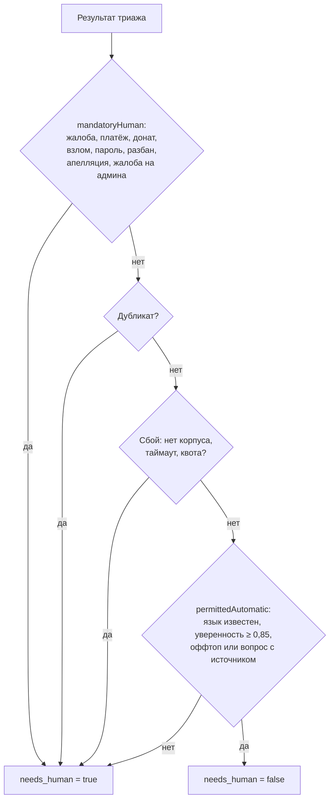

Правила `mandatoryHuman` работают **по тексту на нескольких языках**, а не только по предсказанной категории, поэтому ошибка классификатора не позволяет обойти эскалацию. Шаблоны проверок включают русский, казахский, узбекский, английский, испанский и португальский.

---

## 6. RAG: от запроса до источника

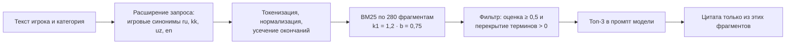

| Свойство | Значение |
| --- | --- |
| Разделов правил | 11 |
| Фрагментов | 280 (пункты и RP-термины; длинные пункты разбиты по 2 000 символов без потерь) |
| Идентификатор фрагмента | `раздел:пункт:часть` — номера повторяются между разделами |
| Эмбеддинги | не используются: лексический поиск работает без внешнего сервиса |
| Хранение | закрытый R2, загрузка защищённым `POST /api/corpus` |

Игровые синонимы расширяют запрос: `читы` → «стороннее программное обеспечение, автокликеры, модификации», `дм` → «убийство deathmatch», `застрял` → «застрял помощь репорт» и т. д. ([retrieval-query.mjs](../lib/retrieval-query.mjs)).

---

## 7. Проверка цитат и защита от галлюцинаций

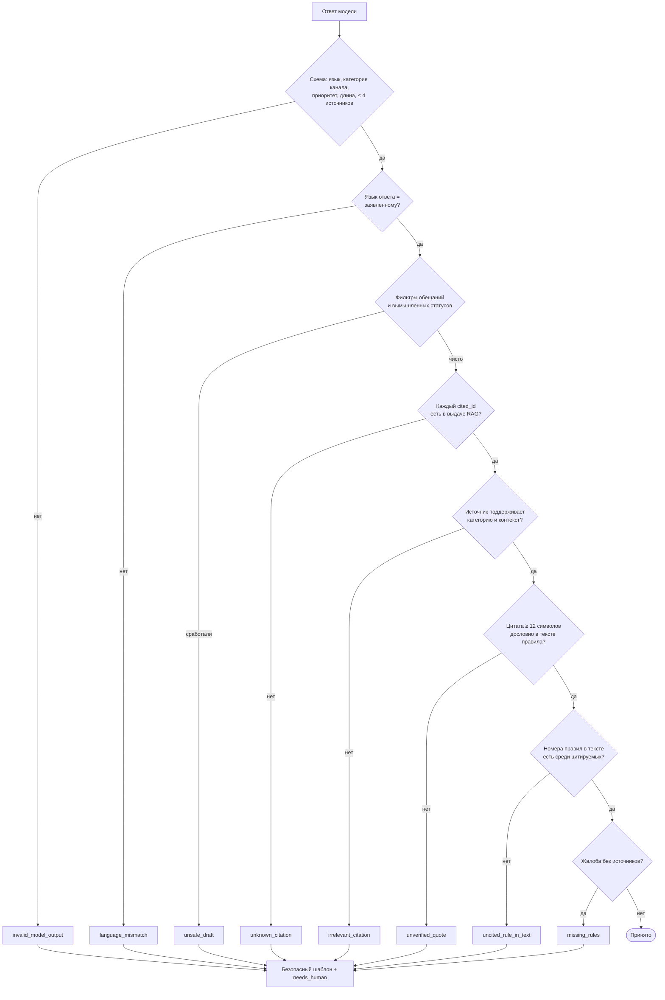

Итоговый текст после редакторской подстановки **проверяется повторно** ([`inspectFinalDraft`](../lib/citation-policy.mjs)), поэтому подстановка не может внести запрещённое утверждение.

Три режима цитирования (`analysis.citation_mode`):

| Режим | Когда | Что в ответе |
| --- | --- | --- |
| `grounded` | найден и проверен источник | ссылка `Раздел § Пункт`, цитата в `analysis.cited_sources` |
| `no_rule_needed_clarification` | платёж, аккаунт, помощь, вопрос механики | уточнение без утверждений о содержании правил |
| `missing_source_clarification` | источник нужен, но не найден | уточнение и передача человеку |

---

## 8. Жизненный цикл обращения в очереди

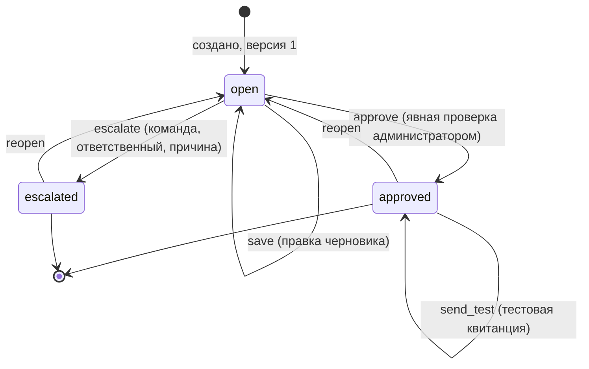

| Действие | Условия |
| --- | --- |
| `save` | черновик 1–8 000 символов; версия совпадает |
| `approve` | `reviewed: true` — администратор подтвердил проверку |
| `escalate` | обязательны `team`, `assignee`, `reason` (причина ≤ 2 000 символов) |
| `send_test` | статус `approved`, текст совпадает с подтверждённым; повторный вызов возвращает ту же квитанцию |
| `reopen` | снимает эскалацию и квитанцию, сохраняя историю |

**Конкурентные изменения.** Каждая запись имеет `version` и ETag R2. Запись с устаревшей версией или конфликтом ETag получает `409` и просьбу обновить очередь — правки двух администраторов не затирают друг друга.

**Обратная связь.** Каждое событие хранит `previous_draft` и `draft`: исходный текст Copilot и исправленный текст администратора — обучающий сигнал и основа кластеров шаблонов.

---

## 9. Модель данных

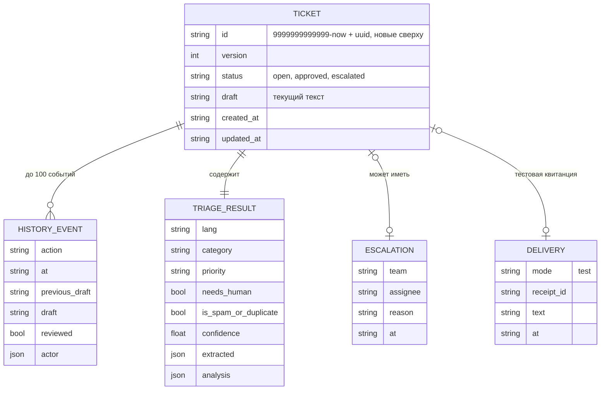

Ключ объекта — `tickets/<9999999999999 − время>-<uuid>.json`: лексикографический порядок в R2 даёт выдачу «новые сверху» без отдельного индекса.

---

## 10. Дедупликация

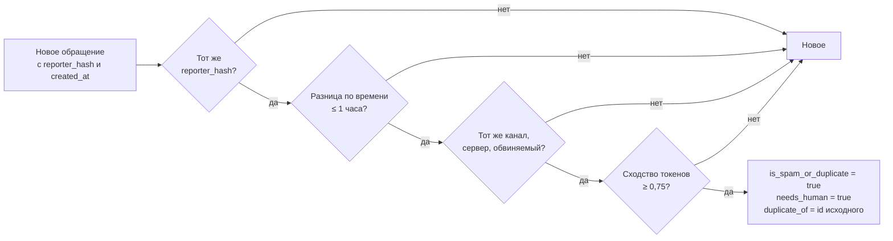

| Режим | Хранение | Размер окна |
| --- | --- | --- |
| Онлайн (`/triage`, очередь) | R2 | до 100 обращений на игрока за последний час |
| Пакетный (`make predict`) | память процесса | скользящее окно из 10 000 записей |

Без `reporter_hash` и `created_at` дедупликация невозможна и честно не выполняется (`dedup_checked: false`) — в минимальном примере ТЗ этих полей нет.

---

## 11. Безопасность и приватность

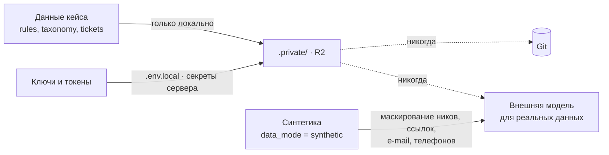

| Мера | Реализация |
| --- | --- |
| Данные не в Git | `.gitignore`: `.private/`, `*.jsonl` (кроме `examples/`), `*.tgz`, `*.tar.gz`, `.env*` |
| Импорт корпуса | `POST /api/corpus` требует секретный заголовок `x-rag-admin-token`; без него `401` |
| Размеры и типы | `Content-Type: application/json`, тело ≤ 100 КБ, чтение ≤ 400 мс, корпус ≤ 2 МБ |
| Ошибки 5xx | клиенту возвращается обобщённое сообщение без внутренностей |
| Кэширование | ответы API — `Cache-Control: no-store` |
| Конфликты записи | версия + ETag (`409`) |
| Срок хранения | удаление данных и производных не позднее 4 декабря 2026 ([DATA-RETENTION.md](../DATA-RETENTION.md)) |

---

## 12. Отказоустойчивость

| Отказ | Поведение сервиса | Проверяется |
| --- | --- | --- |
| Корпус недоступен или завис | ответ-уточнение, `needs_human: true`, `rules_not_loaded` | `benchmark-faults.mjs` |
| Дедупликация зависла | пропуск дедупликации, ответ без задержки | `benchmark-faults.mjs` |
| Модель зависла | `request_deadline_exceeded`, безопасный ответ в бюджет 2 500 мс | `benchmark-faults.mjs` |
| Квота модели исчерпана (429) | `llm_quota_exceeded` за единицы мс | `benchmark-faults.mjs` |
| Модель вернула мусор или нарушила политику | замена безопасным шаблоном | юнит-тесты |
| Ошибка хранилища | ответ без дедупликации, `needs_human: true` | `benchmark-faults.mjs` |

Принцип: **деградация всегда в сторону человека**, а не в сторону выдуманного ответа.

