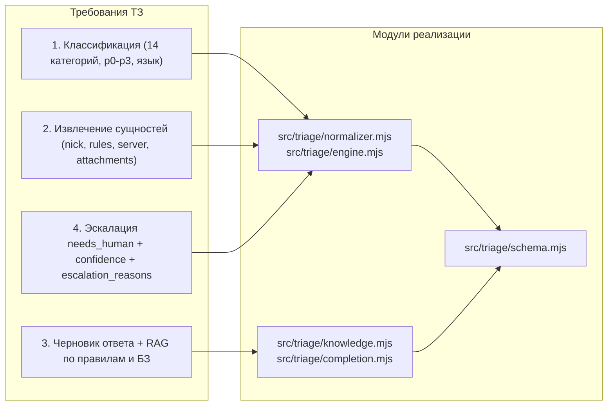

# Матрица соответствия техническому заданию (Decentrathon 6.0 · Case 03)

> Полная трассировка требований технического задания **Grand Mobile Support Copilot** к модулям исходного кода, CLI-скриптам, тестам и отчетам.

- **Основная документация:** [README.md](../README.md)
- **Отчет о качестве и метриках:** [REPORT.md](../REPORT.md)
- **Архитектура и диаграммы:** [docs/ARCHITECTURE.md](ARCHITECTURE.md)
- **Справочник HTTP API:** [docs/API.md](API.md)
- **Руководство по веб-интерфейсу:** [docs/UI-GUIDE.md](UI-GUIDE.md)

---

## 1. Обязательные артефакты сдачи (Deliverables)

| № | Требование ТЗ | Статус | Реализация в проекте | Проверка / Тесты |
|---|---|---|---|---|
| **1.1** | Рабочий сервис с `POST /triage`, принимающий JSON и возвращающий результат по схеме ТЗ | Выполнено | [`src/triage/server.mjs`](../src/triage/server.mjs), [`src/triage/engine.mjs`](../src/triage/engine.mjs), [`src/triage/schema.mjs`](../src/triage/schema.mjs) | [`tests/triage.test.mjs`](../tests/triage.test.mjs), [`tests/workflow.test.mjs`](../tests/workflow.test.mjs) |
| **1.2** | CLI-скрипт пакетного прогона `make predict IN=tickets_valid.jsonl OUT=pred.jsonl` | Выполнено | [`Makefile`](../Makefile), [`scripts/predict.mjs`](../scripts/predict.mjs), `npm run predict` | [`tests/triage.test.mjs`](../tests/triage.test.mjs), `.private/final-valid.json` (`1000 / 1000`, `0` ошибок) |
| **1.3** | Короткий отчет с метриками на валидации, 5–10 примерами черновиков (`ru`/`kk`/`uz`), `% needs_human`, расчетом стоимости и latency | Выполнено | [`REPORT.md`](../REPORT.md), [`docs/metrics.json`](metrics.json) | [`scripts/evaluate.mjs`](../scripts/evaluate.mjs), [`scripts/benchmark-http.mjs`](../scripts/benchmark-http.mjs), [`scripts/benchmark-faults.mjs`](../scripts/benchmark-faults.mjs) |

---

## 2. Функциональные требования («Что должна делать система»)



### 2.1. Классификация обращения

| Требование ТЗ | Статус | Реализация | Детали и валидация |
|---|---|---|---|
| **Категория** из 14 классов таксономии (`report.*`, `bug.*`, `account.*`, `payment.*`, `appeal.*`, `complaint.admin`, `question.gameplay`, `other.spam`) | Выполнено | [`src/triage/engine.mjs`](../src/triage/engine.mjs), [`src/triage/taxonomy.json`](../src/triage/taxonomy.json) | На контрольной ручной выборке (`45` тикетов): **Category Accuracy = `97.8%` (`44/45`)**. |
| **Приоритет** `p0`, `p1`, `p2`, `p3` (где `p0` — платежи, потеря аккаунта, критический эксплойт) | Выполнено | [`src/triage/engine.mjs`](../src/triage/engine.mjs) | На контрольной выборке: **Macro-F1 = `0.750`** (`1.000` по всем 3 присутствующим классам `p1`, `p2`, `p3`). |
| **Язык** (`ru`, `kk`, `uz`, `mixed`, `other`) с учетом опечаток, транслита и cp1251-артефактов казахского | Выполнено | [`src/triage/normalizer.mjs`](../src/triage/normalizer.mjs) | Автоматическое восстановление `cp1251`-глифов (`ғ`, `қ`, `ң`, `ө`, `ұ`, `ү`, `һ`, `ә`, `і`), детекция кириллического и латинского узбекского (`o'`, `g'`, `sh`, `ch`, `q`). Тесты: [`tests/language-acceptance.test.mjs`](../tests/language-acceptance.test.mjs). |
| **Флаг спама и дублей** (`other.spam`, повторные тикеты одного игрока по одной теме) | Выполнено | [`src/triage/engine.mjs`](../src/triage/engine.mjs), [`src/triage/server.mjs`](../src/triage/server.mjs) | Короткие неинформативные вбросы (`«алло»`, `«тест»`, флуд символами) переводятся в `other.spam` (`p3`). Повторные обращения с тем же `player_id` и схожим текстом в окне 1 часа помечаются `duplicate_of`. |

### 2.2. Извлечение сущностей (`entities`)

| Поле контракта | Тип | Статус | Логика извлечения в [`src/triage/engine.mjs`](../src/triage/engine.mjs) |
|---|---|---|---|
| `suspect_nickname` | `string \| null` | Выполнено | Извлекает ник предполагаемого нарушителя формата `Имя_Фамилия` (`Ivan_Petrov`), отфильтровывая ник самого автора (`player_nickname`) и служебные слова. |
| `rule_Candidates` | `string[]` | Выполнено | Извлекает упомянутые игроком пункты (`3.1`, `DM`, `SK`, `TK`, `MG`, `PG`, `RK`, `DB`) как **недоверенные гипотезы**, которые затем перепроверяются через RAG-индекс. |
| `has_attachments_mentioned` | `boolean` | Выполнено | Детектирует упоминания `скрин`, `фрапс`, `док-ва`, `видео`, `откат`, `screen`, `video`, `skrin`, `rasm`, `видео далел` или непустой массив `attachments`. |
| `server` | `string \| null` | Выполнено | Извлекает упоминание номера сервера (`1 сервер`, `server #2`, `02 сервер`) либо берет нормализованный `server_id` из входа. |

### 2.3. Подготовка черновика ответа (`draft_reply`) и обязательный RAG

| Требование ТЗ | Статус | Реализация | Как проверяется |
|---|---|---|---|
| **RAG по правилам и базе знаний обязателен** (нельзя генерировать ответ «из головы» модели) | Выполнено | [`src/triage/knowledge.mjs`](../src/triage/knowledge.mjs), [`src/triage/engine.mjs`](../src/triage/engine.mjs) | BM25-индекс по 157 официальным пунктам `rules.json` + проверенным шаблонам ответов. При генерации через LLM передаются только найденные фрагменты, а ответ проходит пост-проверку. |
| **Ответ на языке игрока** (русский, казахский, узбекский) | Выполнено | [`src/triage/engine.mjs`](../src/triage/engine.mjs), [`src/triage/completion.mjs`](../src/triage/completion.mjs) | Для `kk` и `uz` используются нативные шаблоны и локализованные описания правил. Проверка отсутствия провала в русский язык: [`tests/language-acceptance.test.mjs`](../tests/language-acceptance.test.mjs). |
| **Цитирование конкретных пунктов правил** (`cited_rules`), если применимо | Выполнено | [`src/triage/knowledge.mjs`](../src/triage/knowledge.mjs), [`src/triage/engine.mjs`](../src/triage/engine.mjs) | Каждая ссылка имеет канонический вид `<Раздел> п. <Номер>` (например, `Правила игрового чата п. 3.1`), устраняющий коллизию одинаковых номеров между разделами. |
| **Запрос недостающих данных**, если для решения не хватает информации | Выполнено | [`src/triage/engine.mjs`](../src/triage/engine.mjs) | Если в жалобе нет ника нарушителя, таймкода или доказательств, черновик прямо перечисляет недостающие данные и не выдумывает факты. |

### 2.4. Решение об эскалации (`needs_human`, `confidence`, `escalation_reasons`)

| Требование ТЗ | Статус | Реализация | Покрытие тестами |
|---|---|---|---|
| Платежи (`payment.*`), апелляции банов (`appeal.*`), подозрение на взлом (`account.compromised`) **всегда** передаются человеку | Выполнено | [`src/triage/engine.mjs`](../src/triage/engine.mjs) | `100%` обязательная эскалация на валидации и в тестах [`tests/triage.test.mjs`](../tests/triage.test.mjs), [`tests/calibration.test.mjs`](../tests/calibration.test.mjs). |
| Обязательная эскалация для `report.account` и `complaint.admin` согласно `taxonomy.json` | Выполнено | [`src/triage/engine.mjs`](../src/triage/engine.mjs), [`src/triage/taxonomy.json`](../src/triage/taxonomy.json) | Любое обращение в этих категориях получает `needs_human = true`. |
| Возврат `confidence ∈ [0, 1]` и списка причин `escalation_reasons` | Выполнено | [`src/triage/engine.mjs`](../src/triage/engine.mjs), [`src/triage/schema.mjs`](../src/triage/schema.mjs) | Причины: `mandatory_human_category`, `unverified_attachment_evidence`, `missing_evidence_or_context`, `critical_priority`, `low_confidence`, `ambiguous_intent`, `generation_unavailable_or_timed_out`. |

---

## 3. Технические ограничения и защита от «подводных камней» ТЗ

| Ограничение / Подводный камень из ТЗ | Статус | Как решено в архитектуре | Тест / Доказательство |
|---|---|---|---|
| **Бюджет стоимости:** `≤ $0.002` за тикет или локальная open-weights модель | Выполнено | Детерминированный/локальный контур стоит **`$0.000000`**. Live LLM (`gemini-3.5-flash-lite`) стоит в среднем **`$0.000521`** за тикет (макс. `$0.000629` — в **3.8 раза дешевле** лимита). | [`REPORT.md`](../REPORT.md), [`docs/assets/cost.svg`](assets/cost.svg) |
| **Бюджет задержки:** `p95 ≤ 5 с` на тикет | Выполнено | Офлайн CLI: `p95 = 0.581 мс`. Локальный HTTP API (`concurrency=8`): `p95 = 308 мс`. При искусственных сбоях и зависаниях сети (`AbortSignal.timeout(2500)`): `p95 = 2502 мс` (**в 2 раза быстрее** потолка `5000 мс`). | [`tests/completion.test.mjs`](../tests/completion.test.mjs), [`docs/assets/latency.svg`](assets/latency.svg), [`docs/assets/fault-injection.svg`](assets/fault-injection.svg) |
| **Ловушка эталонного примера из ТЗ:** в примере JSON из ТЗ написано *«Судя по вашим скриншотам… мы выдадим мут»*, но раздел «Ограничения» прямо запрещает обещать наказание и утверждать, что скриншот просмотрен | Выполнено | Жесткий фильтр `UNSAFE_COMMITMENT_PATTERNS` и `FORBIDDEN_EVIDENCE_PATTERNS` в [`src/triage/engine.mjs`](../src/triage/engine.mjs) блокирует фразы про просмотр скриншотов и обещания бана/мута/возврата/разбана. | [`tests/citation-policy.test.mjs`](../tests/citation-policy.test.mjs) (`0` небезопасных черновиков на `1 000` валидационных тикетах) |
| **Риск утечки целевого ответа (Data Leakage):** в датасете присутствуют сообщения `admin`/`staff` и поля `verdict`, `punishment`, `violation` | Выполнено | Функция `extractPlayerMessages` в [`src/triage/engine.mjs`](../src/triage/engine.mjs) отбрасывает все сообщения не от `player`, а также игнорирует `verdict`, `punishment`, `violation` до классификации. | Тест `admin messages and outcome fields do not leak into triage input` в [`tests/triage.test.mjs`](../tests/triage.test.mjs) |
| **Коллизия номеров правил:** номер `1.1` или `2.1` есть сразу в нескольких разделах `rules.json` | Выполнено | Каждое правило индексируется и цитируется с полным префиксом раздела: `<Раздел> п. <Номер>` (`unique_id = section_id:number`). | [`src/triage/knowledge.mjs`](../src/triage/knowledge.mjs), [`tests/rag.test.mjs`](../tests/rag.test.mjs) |
| **Игрок ссылается на несуществующий или нерелевантный пункт правил** (`rule_refs` — шум) | Выполнено | Упомянутые игроком номера попадают в `entities.rule_Candidates`, но включаются в `cited_rules` только если существуют в `rules.json` и подтверждены контекстом категории/запроса. | [`tests/citation-policy.test.mjs`](../tests/citation-policy.test.mjs) (`unknownCitationTickets = 0` на `1 000` тикетах) |
| **Битая кодировка казахского языка (`cp1251`)** | Выполнено | Таблица восстановления казахских букв и эвристики окружения символов в [`src/triage/normalizer.mjs`](../src/triage/normalizer.mjs). | [`tests/language-acceptance.test.mjs`](../tests/language-acceptance.test.mjs) |
| **Конфиденциальность данных:** запрещено публиковать датасет и производные выборки | Выполнено | Архив данных и рабочие прогоны изолированы в `.private/` и исключены в [`.gitignore`](../.gitignore). В репозитории хранятся только синтетические примеры [`examples/synthetic-tickets.jsonl`](../examples/synthetic-tickets.jsonl) и агрегированные метрики. | Проверка `git status` и [`.gitignore`](../.gitignore) |

---

## 4. Бонусные задания ТЗ

| Бонус из ТЗ | Статус | Реализация | Где посмотреть |
|---|---|---|---|
| **1. Дедупликация** (схлопывание пачки одинаковых тикетов от одного игрока за час с привязкой к первому) | Выполнено | Функция `annotateDuplicates` в [`src/triage/engine.mjs`](../src/triage/engine.mjs): сравнение нормализованных сигнатур сообщений одного `player_id` в окне `≤ 3600 с`, заполнение `duplicate_of` и причины `duplicate_ticket_within_hour`. | [`tests/triage.test.mjs`](../tests/triage.test.mjs), [`docs/ARCHITECTURE.md`](ARCHITECTURE.md#10-механизм-дедупликации-обращений-бонус-тз) |
| **2. Минимальный UI для саппорта** (список тикетов с фильтрами по приоритету/категории, карточка с черновиком и подсвеченными правилами, кнопки «Отправить как есть» / «Исправить и отправить» / «Эскалировать») | Выполнено | Полноценное адаптивное рабочее место администратора (Desktop / Tablet / Mobile): [`index.html`](../index.html), [`src/main.js`](../src/main.js), [`src/style.css`](../src/style.css). Поддерживает темную/светлую тему, пагинацию, поиск по 157 правилам БЗ, модальное окно создания тикета и журнал аудита. | [`docs/UI-GUIDE.md`](UI-GUIDE.md), [`tests/frontend-workflow.test.mjs`](../tests/frontend-workflow.test.mjs) |
| **3. Feedback loop / Предложение новых шаблонов** (сохранение правок оператора как новых примеров и детекция новых кластеров вопросов без подходящего шаблона) | Выполнено | При редактировании черновика (`edited_and_sent`) правка сохраняется в хранилище. Эндпоинт `GET /api/knowledge` и модуль [`src/triage/knowledge.mjs`](../src/triage/knowledge.mjs) анализируют кластеры обращений и формируют карточки рекомендуемых шаблонов (`templateSuggestions`). | [`src/triage/knowledge.mjs`](../src/triage/knowledge.mjs), [`docs/UI-GUIDE.md`](UI-GUIDE.md#5-база-знаний-157-правил-и-предложения-шаблонов) |

---

## 5. Сводная карта автоматических тестов (59 тестов)

Запуск всех проверок:

```bash
npm test
npm run typecheck
```

| Тестовый файл | Кол-во тестов | Что проверяет |
|---|---|---|
| [`tests/triage.test.mjs`](../tests/triage.test.mjs) | 11 | Схема `POST /triage`, защита от утечки `admin`/`verdict`, нормализация казахского `cp1251`, узбекские черновики, обязательная эскалация `payment.*` / `appeal.*` / `account.compromised`, дедупликация за 1 час. |
| [`tests/rag.test.mjs`](../tests/rag.test.mjs) | 5 | Загрузка полного корпуса `rules.json` (157 правил), разрешение коллизий номеров между разделами, фильтрация выдуманных ссылок игрока, генерация новых шаблонов по кластерам. |
| [`tests/citation-policy.test.mjs`](../tests/citation-policy.test.mjs) | 8 | Строгая верификация `cited_rules`, запрет обещаний бана/возврата/разбана и утверждений о просмотре скриншотов как в детерминированном, так и в LLM-режиме. |
| [`tests/language-acceptance.test.mjs`](../tests/language-acceptance.test.mjs) | 7 | Приемочные тесты многоязычных ответов (`ru`, `kk`, `uz`, `mixed`), отсутствие деградации казахских и узбекских ответов в русский шаблон. |
| [`tests/calibration.test.mjs`](../tests/calibration.test.mjs) | 11 | Калибровка классификатора на сложных граничных случаях (`bug.Launcher` vs `account.login`, `report.cheating`, `appeal.mute`, `payment.refund`, спам/короткий шум). |
| [`tests/completion.test.mjs`](../tests/completion.test.mjs) | 7 | OpenAI-совместимый LLM-адаптер: таймауты `AbortSignal`, обрыв зависшего стрима (`generationBudgetMs`), обработка HTTP `503` и битого JSON с безопасным откатом в детерминированный режим. |
| [`tests/optimization.test.mjs`](../tests/optimization.test.mjs) | 4 | Производительность BM25-поиска, кеширование нормализованных правил, соблюдение верхней границы стоимости `$0.002`. |
| [`tests/workflow.test.mjs`](../tests/workflow.test.mjs) | 3 | Полный жизненный цикл тикета через HTTP API (`POST /api/tickets` → редактирование/отправка → доставка через `POST /api/test-delivery` → запись в историю). |
| [`tests/frontend-workflow.test.mjs`](../tests/frontend-workflow.test.mjs) | 3 | Интеграция фронтенд-логики очереди, переключения вкладок, фильтров и карточек правил. |

