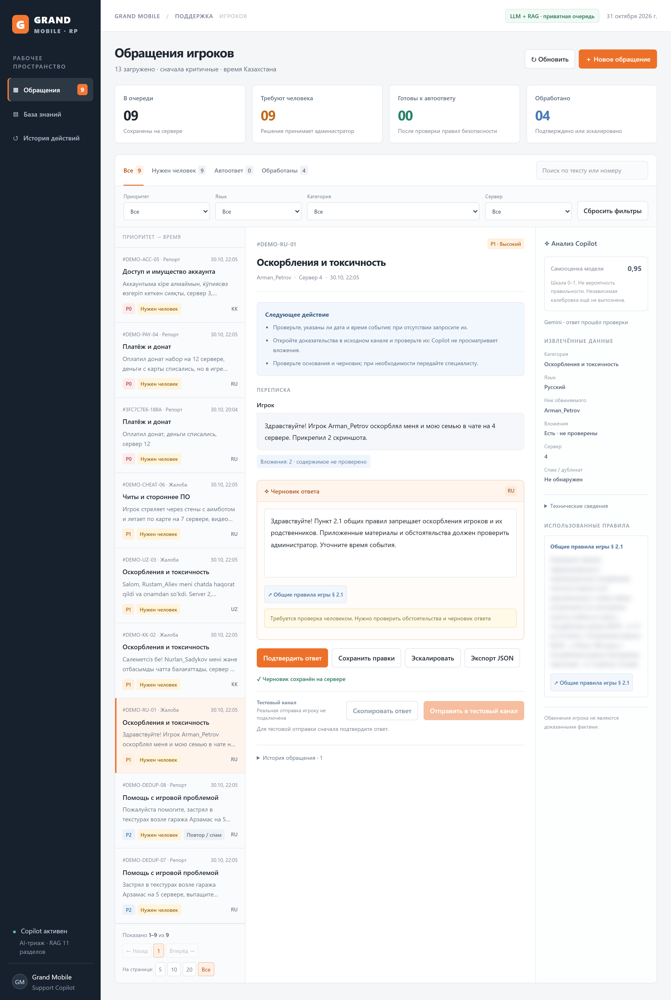
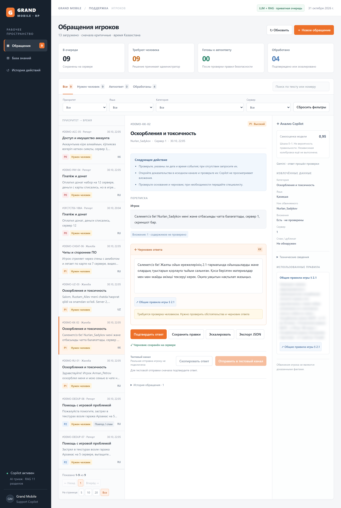
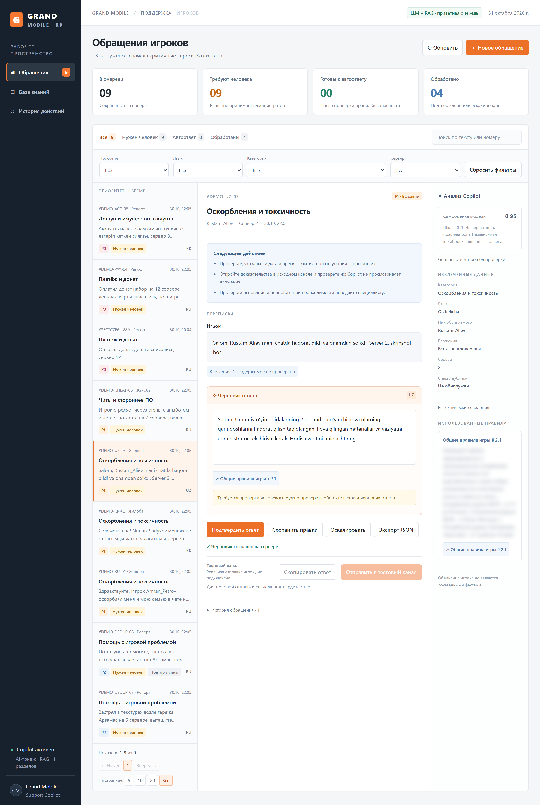
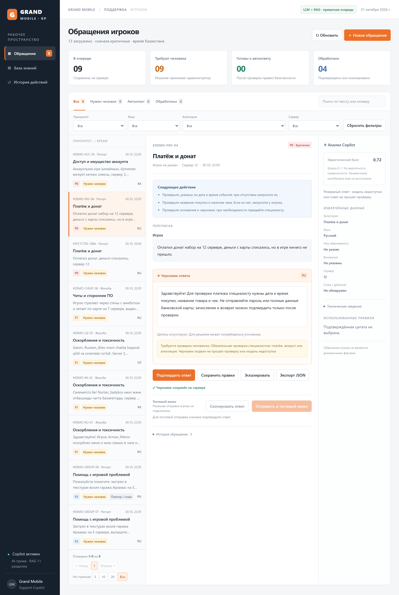
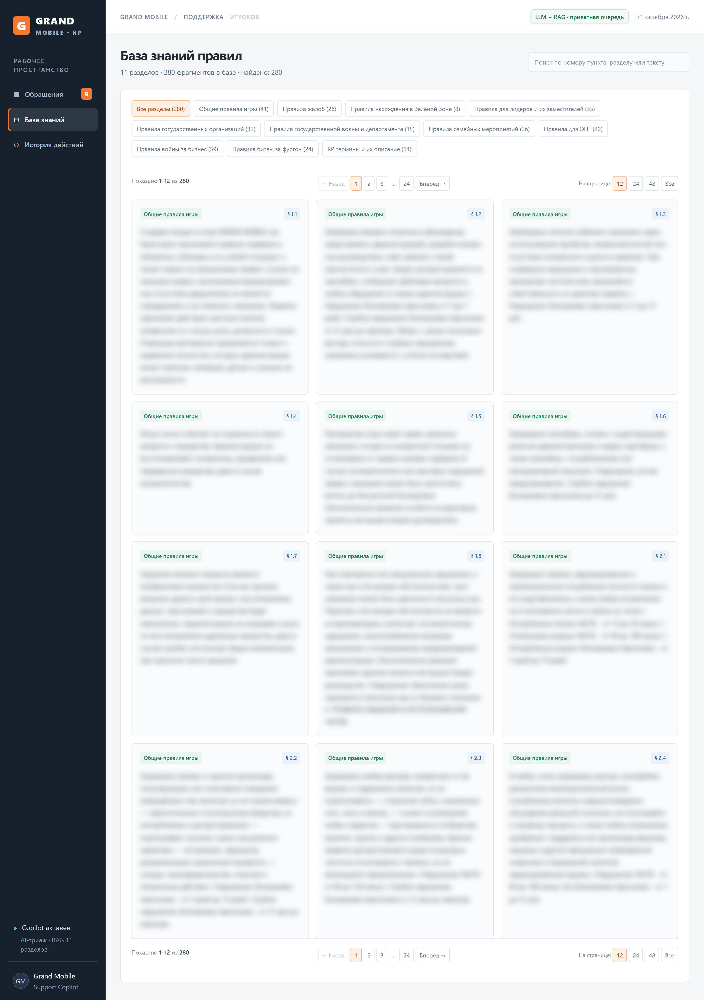
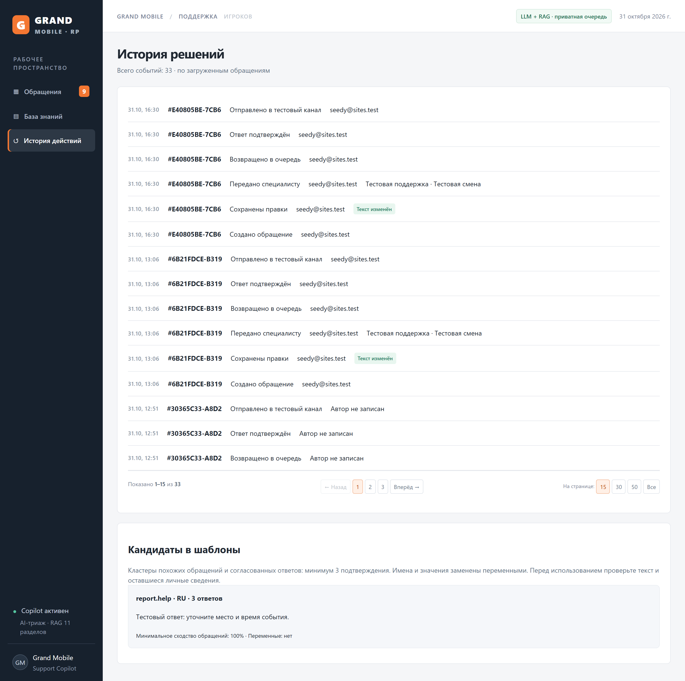
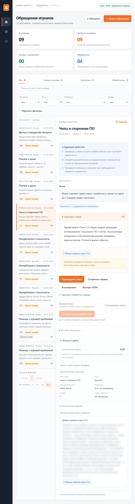
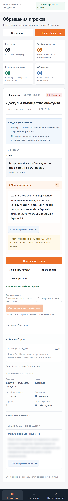

# Руководство по веб-интерфейсу администратора (UI Guide)

> Визуальный обзор рабочего места оператора **Grand Support Copilot**: очередь обращений, карточка тикета с RAG-черновиком и цитатами правил, многоязычные сценарии (`RU` / `KK` / `UZ`), обработка критических инцидентов (`P0`), база знаний на 157 правил, журнал проверенных тикетов и адаптивная верстка.

- **Основная документация:** [README.md](../README.md)
- **Отчет о качестве и метриках:** [REPORT.md](../REPORT.md)
- **Архитектура и диаграммы:** [docs/ARCHITECTURE.md](ARCHITECTURE.md)
- **Справочник HTTP API:** [docs/API.md](API.md)
- **Матрица соответствия ТЗ:** [docs/TZ-COMPLIANCE.md](TZ-COMPLIANCE.md)

> [!NOTE]
> На всех иллюстрациях ниже тексты официальных правил из закрытого датасета намеренно размыты (`CSS blur`) для строгого соблюдения условий неразглашения данных хакатона. В рабочем приложении администратор видит полный текст каждого пункта правил.

---

## 1. Обзор рабочего места оператора (Desktop `1440×900`)



Главный экран спроектирован так, чтобы оператор обрабатывал обращение без лишних переключений контекста:

1. **Левая навигационная панель (Sidebar):**
   - Быстрое переключение между разделами **«Очередь обращений»**, **«База знаний и шаблоны»** и **«История и аудит»** со счетчиками активных элементов.
   - Кнопка **«+ Новое обращение»** для ручного ввода или проверки произвольного тикета в реальном времени.
   - Переключатель **темной и светлой темы** и индикатор статуса API.
2. **Верхняя сводка KPI (Top Metrics Bar):**
   - Отображает общее число тикетов в очереди, количество критических инцидентов **`P0`**, долю обращений, требующих проверки человеком (**`Needs Human`**), и среднюю уверенность классификатора (**`Avg Confidence`**).
3. **Левая колонка рабочей области — Очередь тикетов:**
   - Поиск по тексту сообщения, нику игрока или `ticket_id`.
   - Быстрые фильтры по приоритету (`Все`, `P0`, `P1`, `P2`, `P3`), категории (`14` категорий таксономии), языку (`RU`, `KK`, `UZ`) и флагу `Только эскалации`.
   - Управление размером страницы (`5`, `8`, `12`, `Все`) и пагинация без вложенных скроллбаров.
4. **Правая колонка — Карточка выбранного тикета:**
   - Полная переписка игрока с подсветкой метаданных (сервер, никнейм, вложения, дубликаты).
   - Извлеченные сущности (`suspect_nickname`, `server`, `has_attachments_mentioned`, `rule_Candidates`).
   - Редактируемый черновик ответа (`draft_reply`) с верифицированными ссылками на пункты правил (`cited_rules`).
   - Три целевых действия из бонусного задания ТЗ: **«Отправить как есть»**, **«Исправить и отправить»**, **«Эскалировать профильному специалисту»**.

---

## 2. Многоязычные черновики: Казахский (`KK`) и Узбекский (`UZ`)

Система автоматически восстанавливает поврежденную кодировку казахского языка (`cp1251`-глифы `ғ`, `қ`, `ң`, `ө`, `ұ`, `ү`, `һ`, `ә`, `і`), распознает узбекский язык (латиницу и кириллицу) и формирует черновик ответа строго на языке игрока.

````carousel

<!-- slide -->

````

### Что видит оператор в карточке многоязычного тикета:
- **Языковой бейдж (`KK` / `UZ`)** и нормализованный текст обращения (при наличии `cp1251`-артефактов исходный текст очищается до чтения классификатором).
- **Извлеченный никнейм нарушителя** (например, `Damir_Kairatov` в казахском тикете по оскорблению родных).
- **Точную ссылку на раздел и пункт правил** (`Правила игрового чата п. 3.1`), проверенную через RAG-индекс.
- **Безопасную формулировку черновика:** система объясняет порядок рассмотрения жалобы на казахском или узбекском языке, **не обещая автоматического бана/мута** и **не утверждая, что приложенный скриншот уже просмотрен**.

---

## 3. Критические инциденты (`P0`) и обязательная передача человеку



Для категорий повышенного риска (`payment.*`, `appeal.*`, `account.compromised`, `report.account`, `complaint.admin`) интерфейс применяет жесткие защитные правила:

- Тикет маркируется приоритетом **`P0`** и красным индикатором **«Требуется администратор (`needs_human: true`)»**.
- В блоке причин эскалации (`escalation_reasons`) явно выводятся теги:
  - `mandatory_human_category` — категория требует ручной проверки по регламенту;
  - `critical_priority` — критический приоритет `P0`;
  - `unverified_attachment_evidence` — игрок упоминает чек/скриншот, который должен сверить специалист.
- Черновик ответа запрашивает точные реквизиты транзакции (дату, сумму, способ оплаты, чек) и **никогда не обещает автоматического зачисления доната или возврата средств**.

---

## 4. Создание и проверка нового обращения из интерфейса

Нажатие на кнопку **«+ Новое обращение»** открывает модальное окно живого триажа:

1. Оператор (или проверяющий жюри) вводит текст сообщения на русском, казахском или узбекском языке, указывает сервер, ник игрока и флаг наличия вложений.
2. По клику на **«Запустить триаж»** фронтенд отправляет запрос к `POST /api/tickets` (использующему то же ядро `triageTicket`, что и `POST /triage`).
3. Новый тикет мгновенно появляется в верхней части очереди с рассчитанной категорией, приоритетом, извлеченными сущностями, RAG-черновиком и карточками правил.

---

## 5. База знаний (`157` правил) и предложения шаблонов



Раздел **«База знаний и шаблоны»** объединяет поисковый индекс RAG и аналитику повторяющихся обращений:

- **Полный каталог из 157 официальных правил** (`rules.json`) с разбивкой по 12 разделам проекта и клиентской пагинацией.
- **Мгновенный поиск и фильтрация** по номеру пункта (`3.1`, `2.1`), названию раздела или ключевым словам (`DM`, `SK`, `обман`, `чат`, `лидер`).
- **Блок «Рекомендуемые шаблоны» (`Template Suggestions` — бонус ТЗ):** система анализирует кластеры частых обращений и правок операторов (`edited_and_sent`) и предлагает готовые шаблоны ответов для категорий с высокой нагрузкой.

---

## 6. История решений и журнал доставки (`History & Audit`)



Вкладка **«История и аудит»** обеспечивает прозрачность работы смены саппорта:

- Фиксирует каждое принятое решение: **«Отправлено как есть»** (`approved_as_is`), **«Исправлено оператором»** (`edited_and_sent`) или **«Эскалировано»** (`escalated`).
- Сохраняет финальный текст ответа, время обработки и статус доставки во внешний webhook (`delivered` / `failed` / `skipped`).
- Служит источником данных для **Feedback Loop** (правки операторов автоматически пополняют базу примеров для улучшения шаблонов).

---

## 7. Адаптивная верстка (Tablet `768×1024` и Mobile `390×844`)

Интерфейс полностью адаптирован под планшеты и смартфоны дежурных администраторов без горизонтального скролла и обрезания контента:

````carousel

<!-- slide -->

````

- **На планшетах (`≤ 1024px`):** навигация перестраивается в компактную верхнюю панель, а очередь и карточка тикета располагаются в едином вертикальном потоке с сохранением всех фильтров.
- **На смартфонах (`≤ 640px`):** кнопки действий («Отправить», «Исправить и отправить», «Эскалировать»), бейджи метаданных и пагинация масштабируются под сенсорное управление одной рукой.

